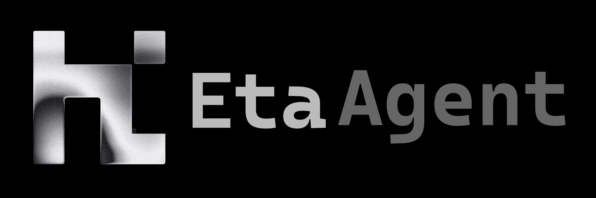
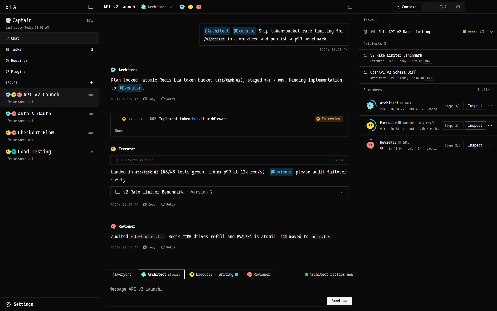
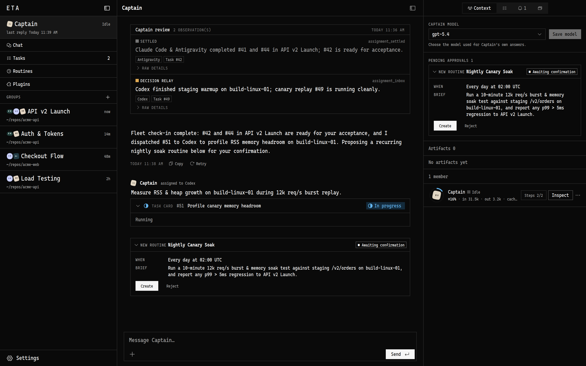
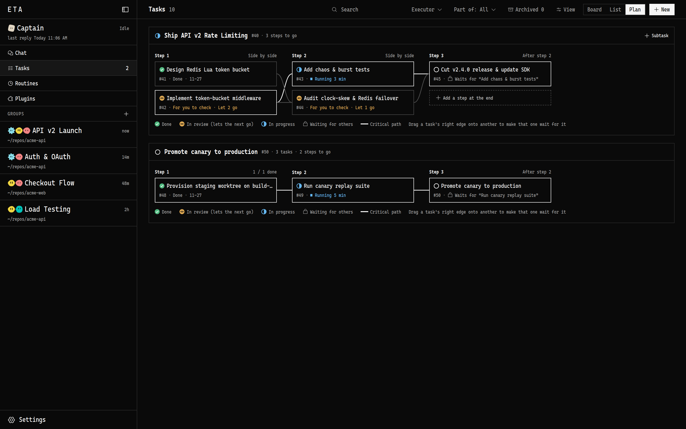

<p align="center">
  
</p>

<p align="center">
  <strong>English</strong> · <a href="README.zh-CN.md">简体中文</a>
</p>

<h2 align="center">
  Command a fleet of coding agents. Ship across every machine.
</h2>

<p align="center">
  Orchestrate multi-agent war rooms combining <strong>Claude Code</strong>, <strong>Codex</strong>, <strong>Antigravity</strong>, <strong>OpenCode</strong>, <strong>Pi</strong>, <strong>ACP</strong>, and native Eta agents — backed by a <code>git worktree</code> task board with dependency DAGs, autonomous <strong>Captain</strong> coordination, multi-machine execution, and native apps across every screen.
</p>

<p align="center">
  <a href="#install">Install</a> ·
  <a href="#multi-agent-war-rooms">War Rooms</a> ·
  <a href="#captain-autonomous-fleet-coordinator">Captain</a> ·
  <a href="#task-board-git-worktrees--dependency-dags">Task DAGs</a> ·
  <a href="#multi-runtime-control-plane">Runtimes</a> ·
  <a href="#multi-machine-fleet">Machines</a> ·
  <a href="#architecture">Architecture</a> ·
  <a href="#documentation">Docs</a>
</p>

<p align="center">
  
</p>

---

## Install

Start with a native desktop or mobile app in seconds, or deploy `eta-host` on an always-on machine so your agent fleet keeps shipping while your laptop is closed.

### Option 1 — Native Apps (Desktop & Mobile — zero-terminal start)

Download the app for your device from [GitHub Releases](https://github.com/0xfe-project/eta/releases), launch it, and choose **Run on this computer** (bundles and manages the local host automatically) or **Connect to an existing host**.

| Platform                      | Package                        | Notes                                                                                                                 |
| ----------------------------- | ------------------------------ | --------------------------------------------------------------------------------------------------------------------- |
| **macOS** (Apple Silicon)     | `eta-desktop-darwin-arm64.dmg` | Drag to Applications; run `xattr -dr com.apple.quarantine /Applications/eta.app` before first launch (unsigned build) |
| **Windows** (x64)             | `eta-desktop-windows-x64.zip`  | Extract and launch `Eta.exe`                                                                                          |
| **Linux** (x64)               | `eta-desktop-linux-x64.tar.gz` | Extract app bundle and launch                                                                                         |
| **Android** (8+, arm64/armv7) | `eta-android.apk`              | Sideload APK; connects via URL or QR code pairing                                                                     |
| **iOS** (15+)                 | `eta-ios.ipa`                  | Sideload via AltStore / Sideloadly or re-sign with your team profile                                                  |
| **HarmonyOS**                 | `eta-harmonyos.hap`            | Sign with your developer certificate before installing on device                                                      |

Prefer a browser or terminal? Every host serves the full **Web UI** on port `:8787`, and the standalone terminal **TUI** (`eta`) connects over the same `/ws` pipe. Desktop and Android clients also receive signed **in-app / OTA updates** directly under **Settings → Update**.

### Option 2 — Always-On Host (24/7 fleets & multi-device access)

`eta-host` is a single self-contained binary on [Latest Releases](https://github.com/0xfe-project/eta/releases/latest) that serves the Web UI, runs local sessions, manages child gateways, and stores all state in `~/.eta`.

**Linux (systemd user service over Tailscale):**

```sh
curl -LO https://github.com/0xfe-project/eta/releases/latest/download/eta-host-linux-x64
chmod +x eta-host-linux-x64
mkdir -p ~/.local/share/eta/host
mv eta-host-linux-x64 ~/.local/share/eta/host/eta-host
~/.local/share/eta/host/eta-host install-service --host tailscale
```

- Omit `--host tailscale` to bind `127.0.0.1` only. On headless servers, run `loginctl enable-linger` so the user service stays active after logout.
- Binding any non-loopback address enables an automatic bearer token gate (`~/.eta/access-token`, mode `0600`). Open `http://<this-machine>:8787/?token=<token>` once in your browser or pair mobile/desktop clients from Settings.
- Want a quick trial without installing a service? Run `./eta-host-linux-x64` directly in a terminal.

**macOS & Windows:**

```sh
# macOS (Apple Silicon) — clear quarantine flag on unsigned binary
curl -LO https://github.com/0xfe-project/eta/releases/latest/download/eta-host-darwin-arm64
chmod +x eta-host-darwin-arm64
xattr -d com.apple.quarantine eta-host-darwin-arm64
./eta-host-darwin-arm64 install-service --host tailscale
```

On Windows, download `eta-host-windows-x64.exe` and run `eta-host-windows-x64.exe install-service` in an Administrator terminal to register a native Windows service under your user account (so agents inherit your local `git`, `gh`, `claude`, and `codex` logins).

**Docker Compose:**

```sh
docker compose -f deploy/compose.yaml up -d --build
docker compose -f deploy/compose.yaml exec eta cat /data/.eta/access-token
```

### First 60 Seconds

1. **Connect models or runtimes:** Open **Settings → Model services** to sign in with ChatGPT/Codex or Grok via device code, or paste OpenAI / Anthropic / Gemini / OpenAI-compatible API keys. Locally installed **Claude Code**, **Codex**, **Antigravity**, **OpenCode**, **Pi**, and **ACP** agents (`~/.eta/acp.json`) are discovered automatically.
2. **Assemble a specialist group:** Create agents for distinct roles (`Architect`, `Executor`, `Reviewer`), assign each its runtime, model, thinking level, and plugins, and invite them into a project group.
3. **Dispatch worktree-isolated tasks:** Mention agents in the war room or promote work onto the Task Board — each task checks out its own `git worktree` (`eta/task-<N>`), tracks live tokens and progress, and reports back for your review.

---

## Multi-Agent War Rooms

Conversations in Eta are project-scoped engineering war rooms where specialist agents collaborate alongside you on a single ordered timeline:

- **`@mention` routing & Steward handoffs:** Addressing `@Executor` wakes only `Executor`; messages without mentions route to the group's **Steward** (or to the sole member in 1-on-1 groups). Agents hand work to each other asynchronously using `mention`, without blocking their own turn.
- **Anti-loop wake budgets:** Automated agent-to-agent mention chains from a single user message are capped by a **5-wake budget** (`WAKE_BUDGET = 5`), preventing runaway ping-pong loops while resetting as soon as you reply.
- **Serial per session, parallel across agents:** Each `(agent × conversation)` pair maintains its own persistent session. Multiple agents work concurrently across conversations or within the same group while each session stays strictly serialized — with **live `steer`** (inject course corrections mid-turn) and **`queue`** delivery.
- **Incremental context briefings:** Every wake-up delivers only messages after that participant's `last_seq` watermark rather than replaying the full group transcript.
- **Inline task cards & artifacts:** Proposals (`task_draft`), live task cards (`task_card`), tool steps, and published static web apps render directly inside the turn that produced them.

---

## Captain: Autonomous Fleet Coordinator

**Captain** is Eta's built-in fleet supervisor — an always-available coordinator with its own dedicated view, supervisor review queue, and cross-group visibility:

- **Supervisor review loop:** Automatically surfaces stalled tasks, failed runs, offline daemons, and settled assignments in structured `<captain-review>` cards so failures never die silently.
- **Cross-group task dispatch:** Captain coordinates specialists across groups via `dispatch_task` without taking on execution itself, tracking assignment rounds and subtask rollups.
- **Approval gates & Inbox:** Sensitive proposals (`create_agent`, `create_group`, `create_routine`) and tool questions wait in structured **Pending Approvals** cards and the **Inbox** before taking effect.
- **Scheduled Routines:** Run recurring checks (`daily`, `weekly`, `hourly`, or 5-field `cron` expressions) with versioned briefs, missed-run safety (never backfills bursts after downtime), and feedback-driven brief revision.

<p align="center">
  
</p>

---

## Task Board, `git worktree`s & Dependency DAGs

Chat stays for discussion; implementation moves to the **Task Board**, where every task executes in its own isolated session and workspace:

<p align="center">
  
</p>

- **Automatic `git worktree` isolation:** Tasks on git projects default to `workspace: worktree`, creating branch `eta/task-<N>` under `~/.eta/worktrees/<project-id>/task-<N>` (or on the target daemon machine) so agents never dirty your primary checkout and parallel tasks never clash.
- **Parent/subtask staging & dependency DAGs:** Agents break large efforts into subtasks (`create_subtask`) and wire `dependsOn` edges. Dependent tasks wait automatically until prerequisites reach `in_review` (or `done` when `requireDone` is set), visualized as a step-by-step **Plan** DAG alongside **Board** (drag-and-drop Kanban) and **List** views.
- **Per-machine concurrency & continuation runs:** Each machine enforces its `maxActiveRuns` slot limit. Leaving a comment on an `in_review` or `blocked` task immediately queues a **continuation run** inside the exact same task session, preserving full working memory.
- **Live execution timelines & token rollups:** Inspect live tool calls, file diffs, terminal exit codes, per-run token usage, and subtask token rollups without leaving the board.

---

## Multi-Runtime Control Plane

Mix best-in-class coding runtimes side by side inside the same group — Eta unifies tool middleware, approvals, MCP tools, and transcripts across every adapter:

| Runtime                                    | Integration                                 | Highlights                                                                                                                     |
| ------------------------------------------ | ------------------------------------------- | ------------------------------------------------------------------------------------------------------------------------------ |
| **Native `eta`**                           | Built-in kernel (`eta-core`, `eta-harness`) | Full streaming, compaction, ESM tool realm, live tok/s telemetry, local & remote execution                                     |
| **Claude Code**                            | `@eta/runtime-oar` (`claude`)               | Native `--plugin-dir` skill loading, MCP injection, session resume, usage tracking                                             |
| **Codex**                                  | `@eta/runtime-oar` (`codex`)                | Device-code ChatGPT/Codex auth or API keys, skill briefing, MCP bridging                                                       |
| **Antigravity**                            | `@eta/runtime-oar` (`antigravity`)          | Full OAR session orchestration with host MCP tool bridging                                                                     |
| **OpenCode / Pi / Grok Build / Qwen Code** | `@eta/runtime-oar`                          | Auto-discovered local CLI runtimes with shared transcript & usage normalization                                                |
| **ACP v1 Agents**                          | `@eta/runtime-acp` (`~/.eta/acp.json`)      | Bring any stdio [Agent Client Protocol](https://agentclientprotocol.com) v1 agent per machine with `session/resume` & host MCP |

Both external runtime adapters expose Eta's built-in tools (`mention`, `draft_task`, `create_subtask`, `publish_artifact`, `get_plugin_config`, etc.) over a local HTTP MCP server (`eta`) with live `tools/list_changed` updates and centralized approval enforcement.

---

## Multi-Machine Fleet

Scale from a laptop to build servers, GPU workstations, and remote Linux boxes using `eta-daemon`:

- **Outbound-dialing architecture:** Daemons dial out over WebSocket (`/machines/connect`) to your primary `eta-host` — no inbound firewall ports or SSH key distribution required on worker machines.
- **Fingerprint pairing:** Generate a 24-hour one-time install code under **Settings → Machines → Add a machine**, run `eta-daemon setup <host-url> <install-code>`, and approve the matching cryptographic key fingerprint.
- **Remote worktrees, MCP & plugin sync:** Sessions run locally on the worker machine (with remote `git worktree`s, local CLI runtimes, and machine-local `~/.eta/acp.json`), while model calls, OAuth MCP credentials, and plugin bundles sync transparently from the primary node.
- **One-click daemon upgrades:** The primary host bundles daemon builds across platforms and updates connected workers automatically (`eta-daemon install-service`). See [Self-hosting](docs/self-hosting.md#more-machines-the-daemon).

---

## Native Clients Everywhere + Web + TUI + OTA

Every Eta surface connects to the same `/ws` pipe protocol (`@eta/client-wire-proto`) with zero REST drift:

- **Native Desktop (`macOS`, `Windows`, `Linux`):** Built with Native Shell (`apps/client`), supporting both embedded local host mode and remote Tailscale/HTTPS hosts, plus signed in-app auto-updates.
- **Mobile (`Android`, `iOS`, `HarmonyOS`):** Full war room, task board, Inbox approvals, and QR code host pairing — plus signed OTA bundle updates on Android.
- **Web UI (`:8787`):** Served directly out of `eta-host` with zero external build steps.
- **Terminal TUI (`eta`):** React + Ink terminal client (`apps/tui`) with temporary or resident host management and `/install-service` handoff.

---

## Architecture

```text
  Native Desktop · Mobile · Web (:8787) · Terminal TUI (eta)
                           │
        One WebSocket (/ws pipe)  +  HTTP (/up, /preview, /share)
                           ▼
┌──────────────────────────────────────────────────────────────────┐
│  eta-host (apps/eta — single Bun process + ~/.eta/eta.sqlite)    │
│                                                                  │
│  • Server Floor (packages/eta-server): targets, state diffs, WS  │
│  • Product Plugins: agents, conversations, tasks, captain,       │
│    routines, artifacts, inbox, machines, plugins, usage          │
│  • LLM Gateway (CLIProxyAPI child) & Web Search (managed SearXNG)│
│  • Local Runtimes: native eta + OAR (Claude/Codex/…) + ACP stdio │
└──────────────┬──────────────────────────────────┬────────────────┘
               │ WSS /machines/connect            │ HTTP (optional)
               ▼                                  ▼
   eta-daemon worker nodes                 Memory Sidecar (apps/memory)
   (remote worktrees, local CLIs, MCP)     (Python + pgvector, optional)
```

---

## Plugins, MCP, Sandboxed Artifacts & Approval Gates

- **Agent Plugins 1.0.0:** Install local plugins (`~/.eta/plugins/`), commit-pinned Git plugins (`{ repo, rev, path }`), or **Composio** integrations. Secrets are AES-256-GCM `seal`ed in SQLite, injected via `PLUGIN_ROOT`/`PLUGIN_DATA`, audited on read, and automatically redacted (`redactionMiddleware`) from model logs and transcripts.
- **Per-Agent MCP with Centralized OAuth:** Load servers from plugins, `~/.eta/mcp.json`, or project `.mcp.json` with lazy connections, optional direct tool promotion, and centralized OAuth 2.0 PKCE login on the primary node that relays refreshed tokens to remote daemons.
- **Sandboxed Visual Artifacts:** Agents call `publish_artifact` to ship interactive HTML/CSS/JS/React reports, benchmarks, and SPAs. Previews run in sandboxed iframes without `allow-same-origin` behind expiring capability URLs (`/preview/...`), with one-click versioned public shares (`/share/...`) and ZIP downloads.
- **Security & Approval Gates:** Any non-loopback bind automatically turns on the `0600` bearer token gate; sensitive tool calls pause in the **Inbox** via tool approval lists and declarative `akhook` rules before execution.

---

## And Yes — 100% Self-Hosted & Yours

- **One binary, one SQLite file:** Your entire state — agents, tasks, approvals, routine briefs, and encrypted credentials — lives in `~/.eta/eta.sqlite` beside plain JSONL session transcripts. Back up or move everything with `$HOME/.eta`.
- **100% BYOK, zero lock-in:** Bring your own API keys, ChatGPT/Codex or Grok subscriptions, or private OpenAI-compatible endpoints. No seats, no credits, no cloud black box.
- **Full observability:** Every turn, reasoning block, tool call, diff, token count, and secret audit lands on your own timeline and database.

---

## Updating

Update from **Settings → Update** in the UI or via CLI:

```sh
eta-host upgrade
```

`eta-host upgrade` verifies `SHA256SUMS`, drains active agent runs, backs up `~/.eta/eta.sqlite` to `~/.eta/backups`, restarts the service, and rolls back automatically if the new build fails `/up` health checks. Connected `eta-daemon` workers follow on reconnect. Desktop and Android clients update from **Settings → Update** via signed OTA channels.

## Documentation

- [Self-hosting](docs/self-hosting.md) — flags, token gate, reverse proxies, `eta-daemon`, upgrades
- [Architecture Overview](docs/architecture/overview.md) — processes, wire protocol, data model, plugins
- [Development](docs/development.md) — repo layout, Bun/Node 24 setup, running from source, CI checks
- [Release](docs/release.md) — release pipelines, checksums, OTA manifests, upgrade testing

## License

Eta is licensed under the [MIT License](LICENSE). Bundled third-party components keep their own licenses — notably the Eta Sans / AKR DWG font is not covered by the MIT License, and compiled host binaries bundle SearXNG (`AGPL-3.0-or-later`). See [THIRD_PARTY_NOTICES.md](THIRD_PARTY_NOTICES.md).
