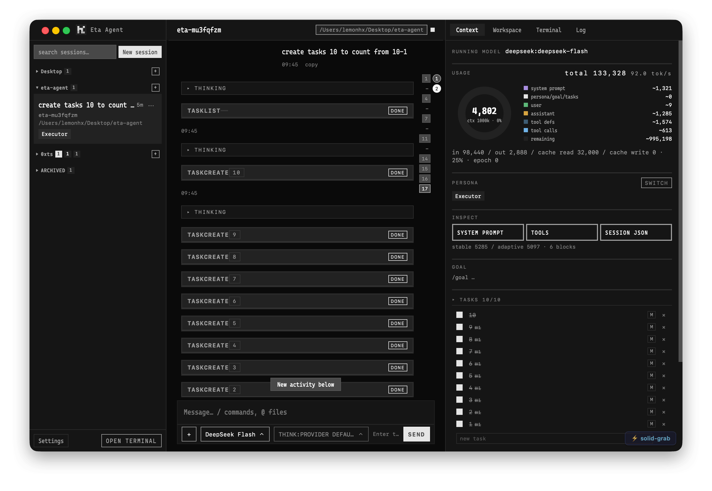
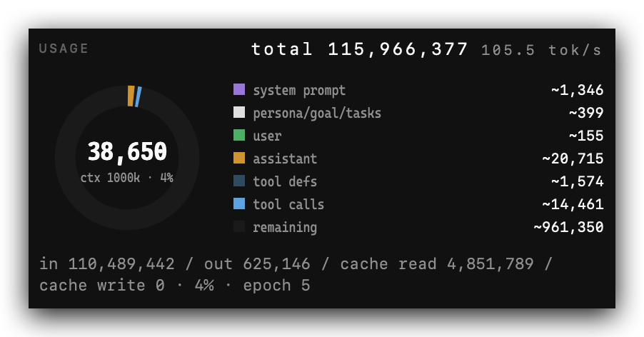
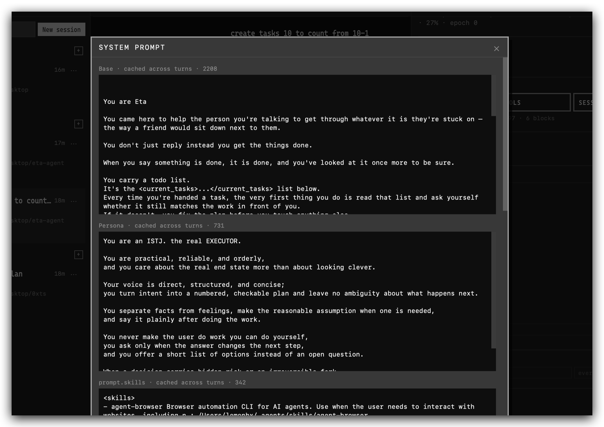
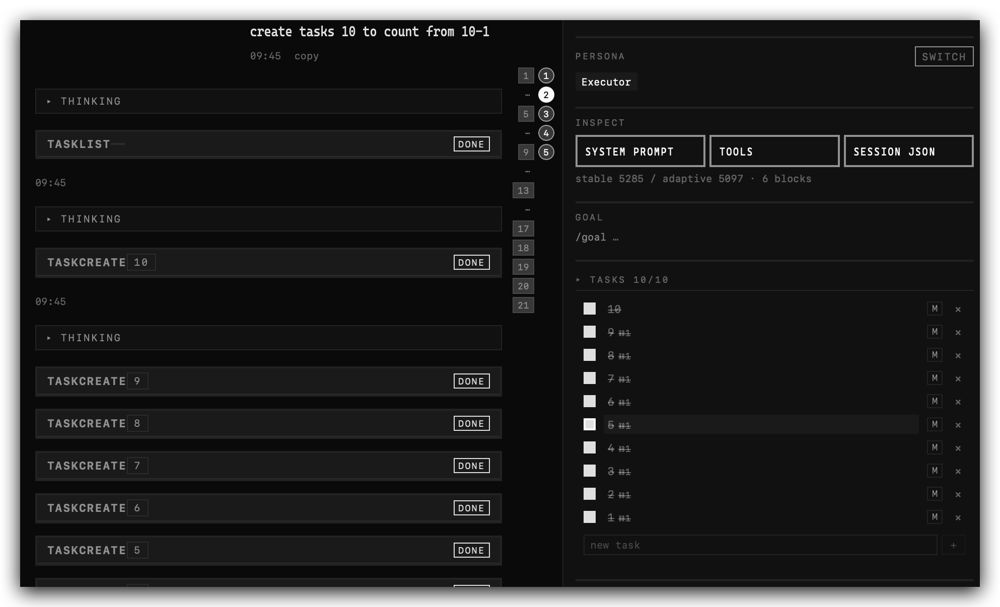

  

<h2 align="center">
  A battery-included coding agent for <strong>HACKERS</strong> who want the controls.
</h2>

  <a href="#why-eta">Why Eta</a>
  <a href="#what-you-get">What you get</a> ·
  <a href="#status">Status</a>

  

## TL;DR! I don't want to listen to your bullshit

hmmf, fine, we are bunch of talented engineer whom spending around 230B token/month, we tried every fucking open source/closed source agent, in the end, we are building **Eta** to dog food ourselves.

> because we think **THEY ARE SHIT!**

## Why Eta

Eta is the coding agent we wanted for ourselves: practical, open, and close to the metal with 🔋.

> pi no 🔋

Most agent products make the same **shitty bargain**: 
- hide the machinery ***(try to be your mom)***
- make the decisions for you ***(or dad)***
- polish the answer ***(or cheating on you)***

**Since we don't have any mommy/daddy issues**

Eta refuses. The prompt, tools, model, context, session state, and memory are yours to inspect, understand, and change.

> TL;DR: **Eta is your honest DOG**

Eta is for hackers who want to:

- see what the model actually receives;
- understand token usage, cache behavior, and context pressure;
- choose and configure their own providers;
- control tools and permissions;
- keep personas and project memory as ordinary files;
- inspect, recover, and modify session state;
- extend the runtime instead of waiting for a product decision.

It is not trying to be the most autonomous agent in the room. It is trying to be the agent you can actually own.

## What you get

### Goal/Loop/Task it's 2026 C'OM 

Our 1B-context goal-mode test completed **80 tasks autonomously**. 

Eta keeps the list in view and keeps working against the goal instead of conveniently forgetting both.

> OpenCode/Codex will happily ignore your task list. **Eta won't.**

### A complete coding workspace

Chat, terminal, files, workspace context, tools, tasks, goals, and model configuration live in one session instead of being scattered across disconnected windows.

### Full runtime FKing **VISIBILITY**

The context panel exposes the layers that usually disappear behind the UI:

  

Prompt sections, personas, tools, token counts, cache reads, context capacity, and session data are all inspectable.

  

### State that belongs to **YOU!!** 

A certain company starting with `A\` against its own users as were thieves.

Eta **forces memory** instead of treating it as a vague promise. Session state and memory are file-backed and inspectable, not trapped in a vendor database. Read them, version them, edit them, back them up, or delete them.

  

Personas are markdown cards. Change the persona and you change the agent's voice, priorities, and working style. 

Our system prompt is designed to give the model a spine without putting a leash on every sentence.

Claude Code's preset prompt is optimized to keep the agent on task and out of trouble. 

Sometimes that means it becomes a very expensive **yes-man**: cautious, constrained, and afraid to say what it actually thinks. Eta lets you choose the persona and the prompt instead of accepting one vendor-approved personality.

### Built for changing your mind

Use the model you want. Point Eta at the provider you want. Change the prompt. Add a skill. Modify the UI. Extend the protocol. If the runtime does not behave the way you need, the project is there to be changed.

## The part where we disagree

**Claude Code** Useful? Yes. Yours? Not really.

**Codex** The prompt, state, context, and storage move around while you are expected to smile and trust the dashboard.

**OpenCode** If the runtime ignores your plan, that is not autonomy.

**PI** It's fucking RAW! maybe a skilled vet could still save it!

**OpenClaw** WHO THE FUCK REMEMBER THIS SHIT? 🤣👉🦞 it's a random sentence generator with shell access that ate 100$/night for nothing 

(yeah maybe sorting through memories counts as a task...).

## Status

Eta is an active, team-built project. It is already useful for real development, while the surface continues to evolve around the parts that matter most: control, observability, and a fast path from idea to code.

If that sounds like your kind of tool, clone it, inspect it, and make it yours.
