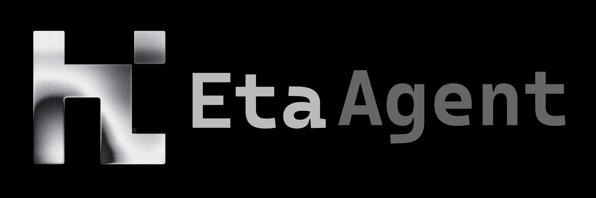

<p align="center">
  
</p>

<h2 align="center">
  Who's holding the AI that knows you?
</h2>

<p align="center">
  <strong>100% transparent. 100% yours.</strong><br />
  An open-source workbench for always-on agents that run on your machine, answer with your own model
  accounts, and keep everything they know in one SQLite file you can open.
</p>

<p align="center">
  <a href="#tldr">TL;DR</a> ·
  <a href="#what-it-is">What it is</a> ·
  <a href="#the-part-where-we-disagree">The part where we disagree</a> ·
  <a href="#run-it">Run it</a> ·
  <a href="#manual">Manual</a> ·
  <a href="#license">License</a>
</p>

## TL;DR

Grok Bot says every agent gets its own computer. True. That computer sits in xAI's datacenter.

Muse gets your mail, your photos, your shopping. Today gets your calendar, your meetings, your work
chat, and promises the memory is "readable, editable, erasable" — on their servers, on their word.

Grok Bot, Muse, Today: different logos, the same trade. They learn everything about you, and they keep
it somewhere you will never be allowed to look.

**We don't think you have to accept the second half.**

eta is the same product with the address changed. The thing that knows you lives on the machine under
your desk. Read its source, watch what it does, swap the model, open the database, carry the whole
thing to another machine with `cp -r`.

> One process. One SQLite file. Zero required external services. 100% BYOK.

## What it is

A workbench where one person directs a crew of always-on agents: each one has a persona, a project it
belongs to, its own tools and its own memory. You talk to them, hand them tasks, put things on a
schedule — and when something needs your OK, they stop and wait for it. Long jobs survive the
conversation that started them; wake-ups arrive only with what's new since the last time the agent
looked.

Nothing here is a black box, because there is no box:

- **Every agent has its own computer — and it's yours.** Run the host on your laptop and the sessions
  run there. Add a second machine and the sessions move: the daemon dials out to you, shows a
  fingerprint, and waits for you to approve it.
- **100% BYOK, not "supports BYOK".** Your ChatGPT, Grok and Gemini subscriptions by device code, any
  OpenAI-compatible endpoint, and the private model in your own rack. A first-class citizen, not a
  compatibility mode. Nothing is routed anywhere you didn't point it.
- **Memory is a SQLite file.** One file, in the same data directory as everything else, queried per
  conversation. Open it, grep it, fix a row, delete a row. Delete it and it's actually gone.
- **You can see the work.** Every turn and every tool call — what it read, what it ran, what it
  changed — lands on a timeline instead of a spinner. When an agent wakes up, it gets the increment,
  not a rewrite of the whole story.
- **Nothing to cancel.** No seat, no credits, no rate limit we invented. There is no account to be
  banned from, because there is no account.
- **The door has a lock that turns itself on.** Bind anything other than loopback and the token gate
  comes up on its own. A file on disk, mode 0600, `Authorization: Bearer` for scripts.

And it's all there to change. Prompts are files, personas are markdown cards, tools are plugins, the
wire is documented frame by frame. If the runtime doesn't behave the way you need, it's not a feature
request away — it's right there.

## The part where we disagree

**Grok Bot** Every agent gets its own computer — in their datacenter, on their dynamic router, which
conveniently never tells you which model actually answered.

**Muse** Ten million users in forty days, and the most popular thing to do with it is shopping. It's
not a workbench, it's a storefront that remembers your address.

**Today** "Memory you can read, edit and erase." Great. Ship me the file, then.

**Claude Code** Useful? Yes. Yours? Not really.

**Codex** The prompt, the state, the context and the storage move around while you're expected to
smile and trust the dashboard.

**OpenCode** If the runtime ignores your plan, that isn't autonomy, it's an argument you keep losing.

## Run it

```sh
git clone https://github.com/0xfe-project/eta.git
cd eta
bun run setup     # install dependencies
bun run dev       # host + web
```

Open http://127.0.0.1:3000, add a model service in Settings — an API key, or a subscription account by
device code — then create an agent and a conversation. Data lands in `$HOME/.eta`, the same directory a
production install uses, so nothing you set up here is throwaway.

`bun run check` runs the same checks CI and the pre-commit hook run.

If that sounds like your kind of tool: clone it, inspect it, and make it yours.

## Manual

Everything below is the reference: what the process is, what the flags are, how to run it on a server,
how to add a machine, where the data lives.

### Layout

```text
apps/
  eta/       host: one Bun process — WebSocket pipe, cordis plugins, SQLite (main node)
  daemon/    eta-daemon: a slim node on another machine, dials back to the main node, runs sessions only
  web/       React UI, reads and writes over that same WebSocket
packages/
  eta-*        kernel, harness, server floor, SSH and git plugins of upstream eta
  client-wire-proto, client-contracts   wire frames and product target types
docs/architecture/   design notes
```

Architecture notes:

- [Overview](docs/architecture/overview.md): processes, layers, code layout
- [Wire protocol and targets](docs/architecture/wire-protocol.md): WebSocket pipe, frames, targets and actions
- [Product model](docs/architecture/product-model.md): agents, machines, projects, conversations, the lead agent, wake-up rules
- [Data](docs/architecture/data.md): SQLite and migrations, session files, data directory layout
- [Phone app](docs/architecture/mobile.md): the Native Shell client, connecting, scanning, packaging
- [Machines and daemon](docs/architecture/machines.md): pairing, epochs, model and tool proxying, remote sessions
- [Access control](docs/architecture/access.md): origin checks, token gate, capability routing
- [LLM gateway](docs/architecture/llm-gateway.md): subscription accounts (Codex, Grok) and Gemini keys, CLIProxyAPI run as a child process of the host
- [Memory](docs/architecture/memory.md): what is stored, how it is queried per conversation
- [Web](docs/architecture/web.md): `web_fetch` and `web_search`, in the host process; SSRF guard, paging, the SearXNG it runs
- [Tasks](docs/architecture/tasks.md): an agent proposes, the user confirms, the same agent executes in a fresh session
- [Tasks, artifacts and routines](docs/architecture/tasks-artifacts-routines.md)

UI conventions live in [DESIGN.md](DESIGN.md) and [apps/web/AGENTS.md](apps/web/AGENTS.md).

### Environment and setup

Needs Bun 1.4.3 (`bun check` is what every package type-checks with) and uv (Python 3.13, fetched by
uv from `.python-version`). The LLM gateway's CLIProxyAPI binary comes with `bun install`. Nothing else
to install and no service to stand up.

```sh
bun run setup     # bun install + uv sync
bun run dev       # host and web dev server
bun run check     # everything CI runs
```

`bun run dev` starts the host and vite together:

- Web: http://127.0.0.1:3000 (`ETA_WEB_PORT` changes the port)
- host: http://127.0.0.1:8787 (`ETA_PORT` changes the port), data in `~/.eta/` — the same directory an
  installed instance uses; vite proxies `/ws` to it and the host allow-lists vite's origin

In the web UI, add a model service under Settings → Model services first (an API key, or a device-code
link for a Codex or Grok subscription, or a Google AI Studio key), then create agents and conversations.

`bun run check` is `dprint check`, `bun run lint:repo` (root eslint) and
`turbo run build typecheck lint test knip`. `bun run format` formats with dprint. CI and the pre-commit
hook run the same set, through turbo's remote cache.

### Running in production

On a Linux or macOS computer, from a checkout, as your own user service:

```sh
bun run host:install -- --host tailscale --port 8790
```

This builds the web, stages the compiled host the way the desktop app carries it (page, migrations,
CLIProxyAPI and the daemon for every platform), puts it in `~/.local/share/eta/host`, and runs
`eta-host install-service <flags>`: a systemd user unit (`io.eta.host`) or launchd agent that starts at
login and restarts on failure, with the PATH you installed from (so agents find git, gh, Claude Code,
Codex). Running it again after `git pull` is one way to upgrade; the daemons follow on their next connect.
On a headless Linux box, `loginctl enable-linger` keeps user services up without a login.
`~/.local/share/eta/host/eta-host uninstall-service` removes the service; the data stays in `~/.eta`.

On Windows a downloaded `eta-host.exe` runs as a real Windows service, started at boot: run
`eta-host install-service <flags>` in an Administrator terminal. It asks for your Windows password once,
because the service runs as you (so agents can read your Claude, Codex and gh logins), and hands it to
Windows without storing it. [docs/release.md](docs/release.md) has the details.

`--host tailscale` listens on the tailnet address only, which is what other machines join over.

A tagged version is that same `eta-host` as one file on GitHub Releases, for Linux x64, macOS arm64 and
Windows x64:
[docs/release.md](docs/release.md) says how to cut one and how to fetch it. An installed file upgrades
itself with no checkout:

```sh
~/.local/share/eta/host/eta-host upgrade            # the latest full release; --check only says
~/.local/share/eta/host/eta-host upgrade 0.2.0-rc.1 # a pre-release has to be named
```

It checks the download, waits for working agents (`--force` does not), backs up the database to
`~/.eta/backups`, restarts the service, and goes back on its own if the new build does not hold. A
process of its own does this, so it outlives the terminal and the host. Settings has the same thing
as a button.
[docs/release.md](docs/release.md) has the details.

Or run the host by hand:

```sh
bun run --cwd apps/web build
HOME=/var/lib/eta bun apps/eta/src/main.ts --web-dir apps/web/dist --host 0.0.0.0 --port 8787
```

The data directory is always `$HOME/.eta`; there is no switch. To move it, move `HOME` (in systemd,
`Environment=HOME=/var/lib/eta`).

Host flags (`apps/eta/src/main.ts`):

| flag                  | meaning                                                                                                                                                                                                                                                                                                                                                                                      |
| --------------------- | -------------------------------------------------------------------------------------------------------------------------------------------------------------------------------------------------------------------------------------------------------------------------------------------------------------------------------------------------------------------------------------------- |
| `--port <n>`          | port, default `8787` (`0` picks any free port)                                                                                                                                                                                                                                                                                                                                               |
| `--host <addr>`       | interface to bind, default `127.0.0.1`; `tailscale` is this computer's tailnet address. **Binding anything other than loopback turns the token gate on**                                                                                                                                                                                                                                     |
| `--web-dir <dir>`     | built web (with `index.html`). A compiled host defaults to the page inside it; otherwise without it the host serves the pipe only, no pages                                                                                                                                                                                                                                                  |
| `--token-file <path>` | turn the token gate on with an explicit token file (created if missing, mode 0600). Binding a non-loopback address without this uses `<data directory>/access-token`                                                                                                                                                                                                                         |
| `--allow-origin <o>`  | extra page origin allowed to open the WebSocket, repeatable. Set it when you sit behind a reverse proxy that rewrites `Host`                                                                                                                                                                                                                                                                 |
| `--github`            | load the GitHub chain (App and wizard, `github` target, `open_pull_request` / `draft_issue` tools, callback routes, machine git/gh login). **Not loaded by default**: if the environment has no GitHub, nothing is created, mounted or asked about, and no GitHub entry appears in the UI. `ETA_GITHUB=1` counts too, `--no-github` overrides it (see [GitHub](docs/architecture/github.md)) |
| `--no-llm`            | don't load the LLM gateway (no subscription accounts, no Gemini keys)                                                                                                                                                                                                                                                                                                                        |
| `--searxng-url <url>` | the SearXNG `web_search` asks (`ETA_SEARXNG_URL` counts too). Without it the host runs the prebuilt SearXNG as a child process on first search, on linux-x64 (glibc 2.35+), darwin-arm64 and win32-x64; elsewhere agents get `web_fetch` only (see [Web](docs/architecture/web.md))                                                                                                          |
| `--no-web`            | don't give agents `web_fetch` and `web_search`                                                                                                                                                                                                                                                                                                                                               |

First visit to a gated host: open `http://host:8787/?token=<token>` once in the browser, then the
cookie takes over; scripts use `Authorization: Bearer <token>`. `/up` is the health check and needs no
token. Details in [Access control](docs/architecture/access.md).

### Behind a reverse proxy

Set `ETA_ALLOW_ORIGIN=https://your.domain`, and give the host `--allow-origin https://your.domain` when
the proxy rewrites `Host`. The proxy has to upgrade WebSocket for `/ws` and `/machines/connect`. `/up`
is the health check and needs no token.

Run it under systemd with `HOME=/var/lib/eta` and everything — database, sessions, artifacts, memory —
lives in that one directory.

### daemon: run sessions on another machine

The daemon is a single file from `bun build --compile`; it holds no web, no database and no model
configuration — model calls and product tools all go back to the main node.

```sh
bun run --cwd apps/daemon build           # produces apps/daemon/out/eta-daemon
```

1. In the main node: Settings → Machines, add a machine, and get a command (the install code is valid
   for 24 hours and works once).
2. On that machine run `eta-daemon setup <main node address> <install code>`. It generates a key
   locally and shows the fingerprint, then waits for approval.
3. Check the fingerprint matches in Settings, then approve.
4. `eta-daemon run` starts it; `eta-daemon install-service` registers a systemd user service (Linux) or
   a launchd agent (macOS).

The daemon only dials out to the main node, which therefore has to be reachable from it (a reverse
proxy has to upgrade `/machines/connect`). Its data directory is `~/.eta/daemon`, the same root as the
host, decided by `$HOME` — no switch. How it works: [Machines and daemon](docs/architecture/machines.md).

### Memory

Memory is a SQLite file in the data directory, next to the sessions and the artifacts, and it is
queried per conversation. There is no separate service to run and nothing to configure: it comes with
the install, it travels with `$HOME/.eta`, and a row you delete stays deleted. See
[Memory](docs/architecture/memory.md).

### Access

Origin checks on the pipe, a token gate that comes up automatically on a non-loopback bind, and
capability routing so a daemon sees only what it needs. The full story is in
[Access control](docs/architecture/access.md).

## License

eta is under the [MIT License](LICENSE). What it carries from others keeps its own terms: the Eta Sans
font is not covered by the MIT License, and a compiled host embeds SearXNG, which is AGPL-3.0-or-later.
See [THIRD_PARTY_NOTICES.md](THIRD_PARTY_NOTICES.md).
