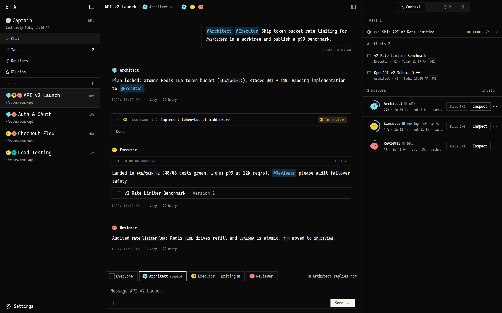
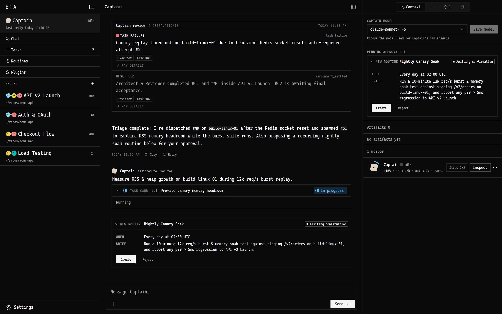
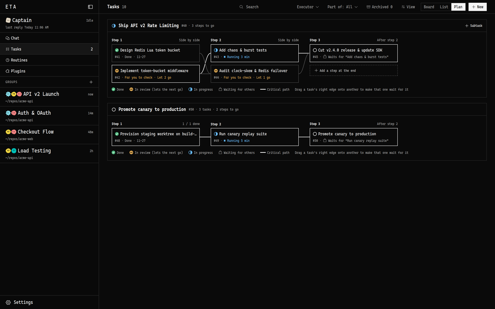

<p align="center">
  
</p>

<p align="center">
  <a href="README.md">English</a> · <strong>简体中文</strong>
</p>

<h2 align="center">
  统帅你的编码 Agent 舰队，跨机器持续交付。
</h2>

<p align="center">
  在一个统一的多 Agent 协同作战室中调度 <strong>Claude Code</strong>、<strong>Codex</strong>、<strong>Antigravity</strong>、<strong>OpenCode</strong>、<strong>Pi</strong>、<strong>ACP</strong> 与 Eta 原生 Agent —— 配备基于 <code>git worktree</code> 与依赖 DAG 的任务看板、<strong>Captain</strong> 自治舰队总控、跨机器分布式执行以及全端原生客户端。
</p>

<p align="center">
  <a href="#快速安装">快速安装</a> ·
  <a href="#多-agent-协同作战室">作战室</a> ·
  <a href="#captain自治舰队总控">Captain</a> ·
  <a href="#任务看板git-worktree-隔离与依赖-dag">任务 DAG</a> ·
  <a href="#多运行时控制平面">多运行时</a> ·
  <a href="#多机舰队">多机扩展</a> ·
  <a href="#架构总览">架构</a> ·
  <a href="#相关文档">文档</a>
</p>

<p align="center">
  
</p>

---

## 快速安装

既可以直接打开桌面端或移动端应用零终端起步，也可以把 `eta-host` 部署在常驻服务器上，让 Agent 舰队在合上笔记本后继续工作。

### 方式一：原生客户端（桌面端 & 移动端，零终端即开即用）

前往 [GitHub Releases](https://github.com/0xfe-project/eta/releases) 下载对应平台的安装包，打开后直接选择 **Run on this computer**（自动拉起并托管本机宿主）或 **Connect to an existing host**（连接已有宿主）。

| 平台                          | 安装包                         | 说明                                                                                                       |
| ----------------------------- | ------------------------------ | ---------------------------------------------------------------------------------------------------------- |
| **macOS** (Apple Silicon)     | `eta-desktop-darwin-arm64.dmg` | 拖入 Applications；安装包暂未签名，首次运行前请执行 `xattr -dr com.apple.quarantine /Applications/eta.app` |
| **Windows** (x64)             | `eta-desktop-windows-x64.zip`  | 解压后运行 `Eta.exe`                                                                                       |
| **Linux** (x64)               | `eta-desktop-linux-x64.tar.gz` | 解压应用目录并启动                                                                                         |
| **Android** (8+, arm64/armv7) | `eta-android.apk`              | 侧载安装 APK，支持地址直连或扫码配对                                                                       |
| **iOS** (15+)                 | `eta-ios.ipa`                  | 可通过 AltStore / Sideloadly 或自签证书安装                                                                |
| **HarmonyOS**                 | `eta-harmonyos.hap`            | 安装至真机前请先使用个人开发者证书签名                                                                     |

习惯浏览器或终端？所有 `eta-host` 均自带完整的 **Web UI**（默认端口 `:8787`），终端 **TUI**（`eta`）也通过同一条 `/ws` 管道连接；桌面端与 Android 客户端均支持在 **Settings → Update** 中接收带签名的 **应用内 / OTA 热更新**。

### 方式二：常驻宿主（7×24 小时舰队与多设备协同）

`eta-host` 是发布在 [Latest Releases](https://github.com/0xfe-project/eta/releases/latest) 的单文件可执行程序，集成了 Web 界面、本地会话引擎与子网关，全部状态保存在 `~/.eta`。

**Linux（通过 Tailscale 部署 systemd 用户服务）：**

```sh
curl -LO https://github.com/0xfe-project/eta/releases/latest/download/eta-host-linux-x64
chmod +x eta-host-linux-x64
mkdir -p ~/.local/share/eta/host
mv eta-host-linux-x64 ~/.local/share/eta/host/eta-host
~/.local/share/eta/host/eta-host install-service --host tailscale
```

- 去掉 `--host tailscale` 则仅监听 `127.0.0.1`；无头服务器请执行 `loginctl enable-linger`，确保退出 SSH 后用户服务继续常驻。
- 只要监听非回环地址，系统会自动开启 Bearer Token 门禁（密钥存于 `~/.eta/access-token`，权限 `0600`）。浏览器首次访问 `http://<this-machine>:8787/?token=<token>` 即可写入凭证，也可在设置中生成配对码连接手机或桌面客户端。
- 想先免安装体验？直接在终端运行 `./eta-host-linux-x64` 即可。

**macOS 与 Windows：**

```sh
# macOS (Apple Silicon) —— 清除未签名二进制的隔离属性
curl -LO https://github.com/0xfe-project/eta/releases/latest/download/eta-host-darwin-arm64
chmod +x eta-host-darwin-arm64
xattr -d com.apple.quarantine eta-host-darwin-arm64
./eta-host-darwin-arm64 install-service --host tailscale
```

Windows 用户可下载 `eta-host-windows-x64.exe`，在管理员终端执行 `eta-host-windows-x64.exe install-service` 注册为系统服务，并以当前用户身份运行（让 Agent 直接继承本机的 `git`、`gh`、`claude` 与 `codex` 登录态）。

**Docker Compose：**

```sh
docker compose -f deploy/compose.yaml up -d --build
docker compose -f deploy/compose.yaml exec eta cat /data/.eta/access-token
```

### 上手前 60 秒

1. **接入模型或本地运行时：** 在 **Settings → Model services** 通过设备码登录 ChatGPT/Codex 或 Grok 订阅，或填入 OpenAI / Anthropic / Gemini / 任意 OpenAI 兼容端点 API Key；本机已安装的 **Claude Code**、**Codex**、**Antigravity**、**OpenCode**、**Pi** 以及 **ACP** Agent（`~/.eta/acp.json`）会自动识别。
2. **组建专职 Agent 小队：** 创建不同职责的 Agent（例如 `Architect`、`Executor`、`Reviewer`），分别指定运行时、模型、推理强度与插件，再将它们拉入同一个项目群组。
3. **派发 Worktree 隔离任务：** 在作战室 `@` 点名协作，或将任务送上看板 —— 每个任务都会自动签出独立的 `git worktree`（`eta/task-<N>`），实时上报进度与 Token 消耗并在完成后交付验收。

---

## 多 Agent 协同作战室

Eta 中的每个群组都是绑定项目工作目录的工程作战室，多位专职 Agent 在同一条有序时间线上与你实时配合：

- **`@mention` 精准点名与 Steward 接管：** `@Executor` 只会唤醒对应成员；未点名任何人的消息将自动路由给群组的 **Steward**（单成员群组则直接唤醒该成员）。Agent 之间也可通过 `mention` 工具异步交接上下文，发起方无需阻塞等待。
- **防死循环唤醒预算：** 单条用户消息触发的 Agent 间连续唤醒链路受 **5 次唤醒预算**（`WAKE_BUDGET = 5`）约束，既保证自主接力协作，又彻底杜绝失控互相刷屏；你再次发言即刻重置计数。
- **单会话串行，多 Agent 并行：** 每个 `(agent × conversation)` 拥有独立的持久化会话。不同 Agent 与不同群组之间完全并发运行，同时保证同一会话内严格串行 —— 并支持在生成过程中实时 **`steer`（中途插话纠偏）** 或 **`queue`（排队投递）**。
- **增量水位线简报：** 每次唤醒仅推送该成员 `last_seq` 水位线之后的增量对话记录，避免无意义的全量重放。
- **内联任务卡与产物预览：** 任务草案（`task_draft`）、实时任务卡（`task_card`）、工具步骤折叠窗以及 Agent 发布的交互式静态站点产物都会内联呈现在对应的消息回合中。

---

## Captain：自治舰队总控

**Captain** 是 Eta 内置的全局舰队总控官，拥有专属总控台、巡检队列与跨群组视野：

- **巡检审查闭环：** 自动捕获阻塞任务、失败运行、离线守护节点与已收敛分配，在时间线生成结构化的 `<captain-review>` 审查卡片，问题不再无声沉没。
- **跨群组任务调度：** Captain 通过 `dispatch_task` 向各项目的专职 Agent 派发与拆分任务（自身不抢占执行权），持续跟踪分配轮次与子树进度。
- **审批门禁与收件箱：** 涉及新建 Agent、新建群组或新建定时例程（`create_agent`、`create_group`、`create_routine`）的提案及高危工具请求，会进入 **Pending Approvals** 与 **Inbox** 等待你的明确授权。
- **定时例程（Routines）：** 支持按天、按周、按小时或 5 段式 `cron` 表达式周期性运行任务；Brief 变更自动保留历史版本，停机期间错过的触发不会雪崩式补跑，你对报告的反馈还能驱动下一次 Brief 自动修订。

<p align="center">
  
</p>

---

## 任务看板、`git worktree` 隔离与依赖 DAG

群聊负责对齐方案与决策，落地执行交给**任务看板** —— 每个任务都在独立会话与隔离工作区中推进：

<p align="center">
  
</p>

- **自动 `git worktree` 隔离：** Git 项目下的任务默认采用 `workspace: worktree` 模式，在 `~/.eta/worktrees/<project-id>/task-<N>`（或对应远程节点）自动拉起分支 `eta/task-<N>`。多任务并行改动互不踩踏，主工作区始终保持干净。
- **父子拆解与依赖 DAG：** 执行器可在运行中通过 `create_subtask` 拆分子任务并声明 `dependsOn` 依赖。前置任务未进入 `in_review`（或要求 `requireDone` 时未达 `done`）前，下游任务会自动等待，并在 **Plan** DAG 视图、**Board** 拖拽看板与 **List** 视图间实时同步。
- **每机并发槽位与评论续跑：** 每台机器通过 `maxActiveRuns` 控制并发上限；当你在 `in_review` 或 `blocked` 任务下发表评论时，系统会在**同一任务会话**中排队拉起**续跑（continuation run）**，完整保留上下文记忆。
- **全过程可观测与 Token 汇总：** 在任务详情页即可查看工具调用、代码 Diff、终端退出码、单次运行 Token 消耗及父子任务汇总。

---

## 多运行时控制平面

在同一个群组中自由混编最适合各自角色的编码运行时 —— Eta 统一接管工具中间件、审批策略、MCP 桥接与运行记录：

| 运行时                                     | 接入方式                                | 核心能力                                                                                                                        |
| ------------------------------------------ | --------------------------------------- | ------------------------------------------------------------------------------------------------------------------------------- |
| **原生 `eta`**                             | 内置内核（`eta-core`、`eta-harness`）   | 原生流式输出、上下文压缩、ESM 工具沙箱、实时 tok/s 速率、支持本机与跨机执行                                                     |
| **Claude Code**                            | `@eta/runtime-oar`（`claude`）          | 原生 `--plugin-dir` 技能挂载、MCP 自动注入、会话恢复与用量统计                                                                  |
| **Codex**                                  | `@eta/runtime-oar`（`codex`）           | 支持 ChatGPT/Codex 设备码登录或 API Key、技能注入与 MCP 桥接                                                                    |
| **Antigravity**                            | `@eta/runtime-oar`（`antigravity`）     | 完整 OAR 会话编排与宿主 MCP 工具透传                                                                                            |
| **OpenCode / Pi / Grok Build / Qwen Code** | `@eta/runtime-oar`                      | 自动发现本机已安装 CLI 运行时，统一标准化流式输出与用量记录                                                                     |
| **ACP v1 Agent**                           | `@eta/runtime-acp`（`~/.eta/acp.json`） | 按机器接入任意基于 stdio 的 [Agent Client Protocol](https://agentclientprotocol.com) v1 Agent，支持 `session/resume` 与宿主 MCP |

所有外部运行时均通过本地 HTTP MCP 服务（`eta`）接入 Eta 宿主工具（`mention`、`draft_task`、`create_subtask`、`publish_artifact`、`get_plugin_config` 等），支持工具列表热更新（`tools/list_changed`）与统一审批拦截。

---

## 多机舰队

通过轻量的 `eta-daemon` 单文件守护进程，将工作负载无缝扩展到构建机、GPU 工作站与远程 Linux 主机：

- **主动外拨零入站端口：** 节点通过 WebSocket 主动外拨至主节点 `/machines/connect`，无需在工作机暴露公网端口或维护复杂的 SSH 密钥分发。
- **一次性安装码 + 指纹核验：** 在 **Settings → Machines → Add a machine** 生成 24 小时有效的一次性安装码，在工作机运行 `eta-daemon setup <host-url> <install-code>` 并在控制台核对密钥指纹后批准上线。
- **远程 Worktree、MCP 与插件同步：** 会话、本地 CLI 与 `~/.eta/acp.json` 直接运行在工作机本地；模型调用、MCP OAuth 凭证与插件文件则由主节点按哈希增量同步并统一代理。
- **主节点统一分发升级：** 主节点内建多平台 daemon 产物，已配对并注册为服务的远程节点会在重连时自动跟随升级（`eta-daemon install-service`）。详见 [自托管指南](docs/self-hosting.md#more-machines-the-daemon)。

---

## 全端原生客户端 + Web + TUI + OTA

所有终端共享同一套 `/ws` 管道协议（`@eta/client-wire-proto`），没有多套接口漂移：

- **原生桌面端（`macOS`、`Windows`、`Linux`）：** 基于 Native Shell 构建（`apps/client`），同时支持**本机托管模式**与**连接远程宿主**，并支持签名校验的应用内自动更新。
- **原生移动端（`Android`、`iOS`、`HarmonyOS`）：** 随身查看作战室、任务看板与 Inbox 审批，支持扫码配对宿主；Android 端支持签名 OTA 热更新。
- **内建 Web UI（`:8787`）：** 由 `eta-host` 直接提供静态站点服务，开箱即用。
- **终端 TUI（`eta`）：** 基于 React + Ink 的全屏终端界面（`apps/tui`），支持临时宿主、连接常驻宿主及 `/install-service` 平滑移交。

---

## 架构总览

```text
  桌面端原生应用 · 移动端原生应用 · Web UI (:8787) · 终端 TUI (eta)
                               │
        统一 WebSocket (/ws 管道)  +  HTTP (/up, /preview, /share)
                               ▼
┌──────────────────────────────────────────────────────────────────────┐
│  eta-host (apps/eta — 单 Bun 进程 + ~/.eta/eta.sqlite)               │
│                                                                      │
│  • 服务端底座 (packages/eta-server)：Target 注册表、增量状态推送、WS  │
│  • 产品插件：agents, conversations, tasks, captain, routines,        │
│    artifacts, inbox, machines, plugins, usage                        │
│  • 模型网关 (CLIProxyAPI 子进程) 与网页搜索 (托管 SearXNG 子进程)    │
│  • 本地运行时：原生 eta + OAR (Claude/Codex/…) + ACP stdio          │
└──────────────────┬──────────────────────────────────┬────────────────┘
                   │ WSS /machines/connect            │ HTTP（可选）
                   ▼                                  ▼
      eta-daemon 远程工作节点                  Memory Sidecar (apps/memory)
      （远程 worktree、本地 CLI、MCP）         （Python + pgvector，按需启用）
```

---

## 插件、每 Agent 独立 MCP、沙箱产物与审批门禁

- **Agent Plugins 1.0.0 生态：** 支持加载本地插件目录（`~/.eta/plugins/`）、锁定提交哈希的 Git 插件（`{ repo, rev, path }`）以及 **Composio** 连接器市场。插件密钥通过 AES-256-GCM `seal` 加密持久化，注入 `PLUGIN_ROOT`/`PLUGIN_DATA`，读取留痕审计，并由 `redactionMiddleware` 在写入模型上下文与日志前自动脱敏。
- **每 Agent 独立 MCP 与集中 OAuth：** 自动合并插件、`~/.eta/mcp.json` 与项目 `.mcp.json`，支持惰性建连与按需暴露直连工具；远程 HTTP MCP 的 OAuth 2.0 PKCE 授权集中在主节点完成，刷新的 Token 自动安全中继至远程工作节点。
- **沙箱化交互产物（Artifacts）：** Agent 可调用 `publish_artifact` 发布交互式 HTML/CSS/JS/React 报告、基准看板或 SPA。所有预览均运行在无 `allow-same-origin` 的隔离 iframe 中（一小时有效签名预览路径 `/preview/...`），并支持多版本管理、公开分享链接（`/share/...`）与 ZIP 打包下载。
- **自动锁门与工具审批：** 监听非回环地址即自动启用 `0600` Token 门禁；高敏工具通过工具审批清单与 `akhook` 声明式规则在 **Inbox** 拦截确认后再执行。

---

## 而且，完全自托管、100% 属于你

- **一个二进制，一个 SQLite 文件：** 所有 Agent 配置、任务图谱、审批记录与加密凭证都保存在 `~/.eta/eta.sqlite`，会话日志以纯文本 JSONL 存放在同级目录；复制 `$HOME/.eta` 即可完成整套迁移或备份，无需额外数据库。
- **100% BYOK，无任何账号锁定：** 直接使用你自己的 API Key、ChatGPT/Codex 或 Grok 订阅，或指向私有集群端点；没有席位费、没有积分抽水、没有云端黑盒。
- **全程白盒可观测：** 每一次推理过程、工具入参、文件 Diff、Token 消耗与密钥读取审计都落在你自己的数据库与时间线里。

---

## 升级维护

直接在界面 **Settings → Update** 一键升级，或在宿主机终端执行：

```sh
eta-host upgrade
```

升级流程会自动校验 `SHA256SUMS`、等待在途 Agent 回合平滑排空、将 `~/.eta/eta.sqlite` 备份至 `~/.eta/backups`、重启服务，并在新版本未能通过 `/up` 健康检查时自动回滚；已连接的 `eta-daemon` 节点会在重连时同步更新。桌面端与 Android 客户端同样可在 **Settings → Update** 通过签名渠道完成更新。

## 相关文档

- [自托管指南](docs/self-hosting.md) — 启动参数、Token 门禁、反向代理、`eta-daemon` 与版本升级
- [架构总览](docs/architecture/overview.md) — 进程模型、管道协议、数据目录与插件分层
- [开发指南](docs/development.md) — 仓库结构、Bun / Node 24 环境配置、源码启动与 CI 校验
- [发布流程](docs/release.md) — 版本打包流水线、校验和、OTA 清单与跨版本升级测试

## 开源协议

Eta 基于 [MIT 协议](LICENSE)开源。仓库内随附的第三方组件保留其各自许可条款 —— 其中 Eta Sans / AKR DWG 字体不适用 MIT 协议，编译后的宿主机二进制内嵌了以 `AGPL-3.0-or-later` 授权的 SearXNG。完整声明请参阅 [THIRD_PARTY_NOTICES.md](THIRD_PARTY_NOTICES.md)。
