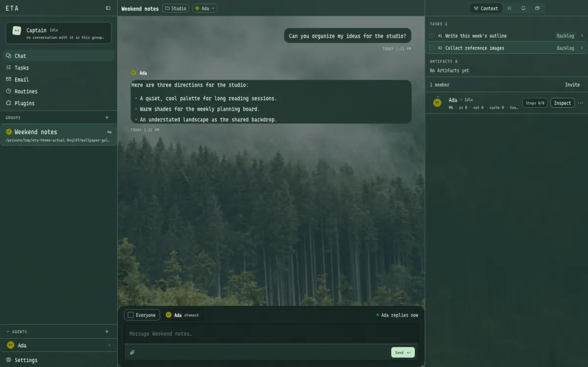

# Eta Theme Studio

Eta Theme Studio is an optional Chrome and Edge extension that applies wallpapers and custom
colors to Eta's NSH Web client. It runs alongside an existing Eta installation and has its own
editor and per-site on/off control.



Wallpaper in the screenshot by [Oleksii Rozanov](https://unsplash.com/photos/misty-forest-with-tall-pine-trees-on-a-hillside-_bN1UXyRSj0)
under the [Unsplash License](https://unsplash.com/license).

## Install

1. Run `npm ci` and `npm run build` in this directory.
2. Open `chrome://extensions` or `edge://extensions`, turn on Developer mode, and load the generated
   `dist/extension/` folder as an unpacked extension.
3. Open your Eta Web instance and click **Eta Theme Studio** in the browser toolbar. The editor
   opens with the site address filled in.
4. Click **Enable theme** (`启用主题`) and grant access to that site. Changes save automatically.
   Click **Disable theme** (`停用主题`) to restore the site's appearance.

The editor is currently in Simplified Chinese. The extension stores one theme in the local
browser and applies it to each enabled site. The browser grants permission at the hostname
level. The extension checks the saved origin, including its port, and the presence of Eta's
application root before applying styles.

## Customize and share

- Change the canvas, surfaces, borders, text, accents, and status colors.
- Import a PNG, JPEG, GIF, or WebP wallpaper up to 4 MB. Adjust fit and overlay opacity. The
  extension hides animated wallpapers when the browser reports a reduced-motion preference.
- Adjust the corner radius of sidebars, panels, message bubbles, composers, cards, buttons,
  and dialogs. Background opacity is available on the relevant surfaces.
- Preview chat, the task board, and settings in the editor.

Exported ZIPs contain `theme.json` and the optional image. The version 1 manifest uses hex
colors, a light or dark base palette, component settings, and a named wallpaper file.
Standalone `theme.json` files without a wallpaper can also be imported.

## Develop

```sh
npm ci
npm test
npm run build
```

The browser adapter uses Eta's existing component identifiers, palette values, and NSH Web
styles. It was verified on Eta `2f7f499` in Chrome for Testing. Changes to the Web renderer may
require adapter updates. Native clients would need their own renderer for the same theme
manifest.
