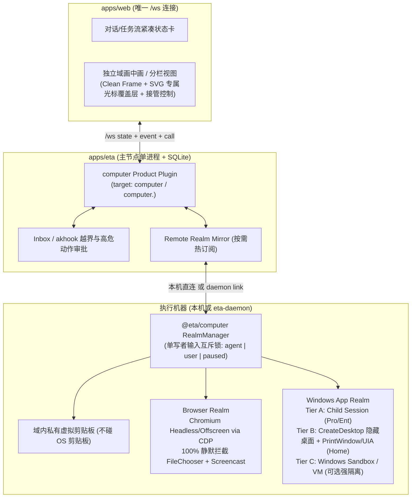
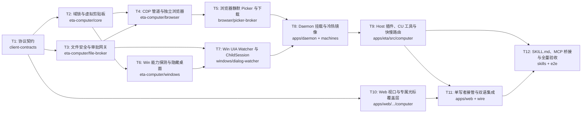

# ETA Computer Use 独立域插件架构方案

## 1. 问题陈述与核心判断

我们需要为 ETA 设计一套 **Computer Use（独立域计算机操控）** 体系，使 Agent 能够独立启动受控浏览器或原生 Windows 应用并进行观测与交互，同时严格满足以下硬约束：

1. **独立域隔离（Zero Contention）**：绝不与人类用户争抢主桌面的物理鼠标指针、键盘焦点与系统剪贴板，支持最小化/收起面板后台持续运行。
2. **文件选择器（File Picker）静默处理**：消除网页 `<input type="file">` 与原生 Windows 打开/另存为（`IFileDialog` / `GetOpenFileName`）模态框对主桌面的阻塞或抢焦点，在项目工作区与授权附件范围内静默完成注入，越界时走 ETA `inbox` 审批。
3. **专属覆盖视觉与虚拟光标（Overlay & Agent Cursor）**：在不污染发给多模态大模型的原始截图（Clean Frame）的前提下，于 ETA 工作台 UI 上渲染一层高完成度的覆盖层，拥有 Agent 自己的鼠标光标、移动插值、点击脉冲与一键「接管 / 交还」控制权切换。
4. **契合 ETA 项目哲学与前沿趋势**：
   - **ETA 哲学**：单进程 `eta-host` + 单 SQLite 文件 + 唯一 `/ws` 管道（不另开私有 WebSocket 或散装 REST）+ `eta-daemon` 多机同构 + 100% BYOK 模型无关 + 消融克制的直角仪表盘 UI（`DESIGN.md`：60ms linear、颜色变量、中英双语、掌控感与心流优先）。
   - **近 7 天前沿报告启示（2026.11.12–11.18）**：
     - **隔离沙箱跑在受控域内**（对照 `terminal-mac`、`vercel-labs/agent-desktop`、`deskpilot`/`agentc`）：不在用户主活动桌面上硬注入 `SendInput`。
     - **纯像素优先 + 选择性放大复核，不强依赖残缺无障碍树**（对照 `pixeltree`、`Accessibility Debt`、`GroundCascade`、`Andee` 微信 `FLAG_SECURE` 踩坑）：强视觉模型直接读干净截图效果优于强塞冗余树，对小目标采用全屏定位 + 局部 Crop 放大二次确认（`GroundCascade` 思路），UIA 仅作原生对话框/控件级精确操作辅助，且内置敏感窗口黑名单避免触发反自动化风控。
     - **快慢模型路由与「先探索再固化」**（对照 `Gemini 4 Hydrogen / Orchestrator`、`Hy4 flash`、`CVS cua-agent-kit`）：保留轨迹日志，支持将跑通的 GUI 探索固化为确定性脚本或 Routine。
     - **独立完成判定（Judge）**（对照 `Actor, Judge, or Teacher?`、`SO-Arena`）：不轻信执行模型的自我宣告 `terminate`，在文件落盘、DOM 变更或窗口状态上做确定性/独立校验。

---

## 2. 总体架构设计

### 2.1 双层插件形态：内置 Product Plugin + 标准 Agent Plugin 桥接

ETA 代码库中存在两种“插件”概念：

- **外部 Agent Plugin（`~/.eta/plugins/<name>/`）**：遵循 Agent Plugins 1.0.0（`plugin.json` + `skills/` + `mcp.json`），适合给 Claude Code / Codex / OpenCode 等外部 Runtime 注入工具和技能，但无法直接向 `apps/web` 注册实时画面状态或复用 `/ws` 管道。
- **内置 Product Plugin（`apps/eta/src/computer/`）**：Cordis 插件，注入 `wire` 与 `sessions`，共享唯一 `/ws` 管道、SQLite、审批中间件（`akhook` / `inbox`）和远程机器链路（`apps/daemon`）。

**设计方案采用「核心内置 + MCP 导出」双层同构：**

1. **核心层（`@eta/computer` 包 + `apps/eta/src/computer/`）**：
   - 在 `packages/eta-computer` 实现与具体业务解耦的独立域驱动引擎（Browser Realm 与 Windows App Realm），供主节点 `apps/eta` 和远程节点 `apps/daemon` 共同调用（类似 `@eta/places` 同时运行在 host 与 daemon）。
   - 在 `apps/eta/src/computer/` 注册 Product Plugin：提供 wire targets（`computer`、`computer.<realmId>`）、内置会话工具（`computer_open`、`computer_observe`、`computer_act`、`computer_Clipboard`、`computer_picker_rule`、`computer_close`），以及远程机器镜像转发。
2. **兼容层（内置 MCP / Skill 桥接）**：
   - 暴露标准 `SKILL.md`（教授 Observe → Act → Verify 循环与 `GroundCascade` 局部放大技巧）及薄封装 MCP 入口，使运行在 Claude Code / Codex 等外部 Runtime 的会话同样能创建并操控 ETA 管理的独立域，同时用户在 ETA Web 界面上依然看得到同一个实时画面和 Agent 光标。

---

## 3. 四大核心技术难题的精确解法

### 3.1 独立域控制：如何做到不抢鼠标、键盘、焦点与剪贴板？

我们将操控目标抽象为统一的 **`ComputerRealm`（独立操控域）**，每个域绑定到 `(sessionId / taskId, machineId)`，内部维护独立的虚拟指针坐标 `(cursorX, cursorY)`、按键状态与**私有内存剪贴板 `VirtualClipboard`**。

#### 引擎一：`BrowserRealm`（独立受控浏览器域 —— 全平台即用，主力推荐）

- **启动方式**：通过本机已安装的 Edge / Chrome（利用 `--headless=new`、`--user-data-dir=<realm-profile>`、`--remote-debugging-pipe` 零端口暴露）启动完全独立的浏览器实例。
- **零抢占原理**：
  - 鼠标、滚轮、键盘全部走 CDP `Input.dispatchMouseEvent` / `Input.dispatchKeyEvent`，事件直接进入 Blink 渲染进程合成器，**根本不经过 Windows `WinSta0` 系统输入队列**，用户物理鼠标纹丝不动。
  - **剪贴板隔离**：拦截 Agent 的复制/粘贴动作，读写 `VirtualClipboard` 并通过 CDP / 页面合成 `ClipboardEvent` 或可编辑元素事务完成传输，**绝不调用 OS 级 `OpenClipboard`**。
  - **后台运行**：无可见顶层 HWND，最小化或关闭 ETA 预览面板仍在后台全速运行。

#### 引擎二：`WindowsAppRealm`（原生桌面应用域 —— 分级适配 Windows 版本）

针对 Win32 / WPF / WinUI / Office 等非网页软件，Windows 的输入与剪贴板归属于 `WinSta0`。为了兼容包括 Windows Home 在内的不同环境，设计 **两级自适应驱动（加可选沙箱级）**：

| 级别                                                  | 适用环境                                            | 核心机制                                                                                                                                                               | 鼠键/焦点隔离                                                                                                                                                                                          | 剪贴板隔离                                                                                                                                                    | 局限说明                                                                                                                          |
| ----------------------------------------------------- | --------------------------------------------------- | ---------------------------------------------------------------------------------------------------------------------------------------------------------------------- | ------------------------------------------------------------------------------------------------------------------------------------------------------------------------------------------------------ | ------------------------------------------------------------------------------------------------------------------------------------------------------------- | --------------------------------------------------------------------------------------------------------------------------------- |
| **Tier A：Child Session（首选完整桌面域）**           | Windows 10/11 Pro、Enterprise、Server               | 调用 `WTSEnableChildSessions` + 无界面/离屏宿主的 `IMsRdpClient`（`ConnectToChildSession = true`）建立本机子会话，在子会话内运行轻量 `eta-cu-helper.exe`。             | 子会话拥有独立的 `WinSta0` 与独立桌面，内部 `SendInput` 100% 独立于父会话。                                                                                                                            | 显式设置 `RedirectClipboard = FALSE` 且 `ManualClipboardSyncEnabled = TRUE`，剪贴板天然按会话物理隔离。                                                       | Windows Home 不支持；需父会话保持登录；每台机器限 1 个并发活动子会话（由 `RealmManager` 排队复用）。                              |
| **Tier B：Hidden Desktop（Windows Home 原生回退域）** | Windows Home (`Core`) 及未开启 Child Session 的机器 | 调用 `CreateDesktopW("eta-realm-<id>")` 创建同窗口站下的**非活动隐藏桌面**，用 `STARTUPINFOW.lpDesktop` 将目标进程启动在该隐藏桌面上（**绝不调用 `SwitchDesktop`**）。 | 画面捕获采用 `PrintWindow(hwnd, hdc, PW_RENDERFULLCONTENT)`；输入采用 UIA Pattern（`Invoke`/`Value`）+ 窗口级消息（`PostMessage`）合成，不调用全局 `SendInput`，因此不移动用户鼠标、不切走主桌面焦点。 | 同一 `WinSta0` 共享系统剪贴板，因此 Helper **禁止使用 `Ctrl+C/V` 走系统剪贴板**，文本读写一律走 `WM_SETTEXT` / UIA `ValuePattern` + 域内 `VirtualClipboard`。 | 部分重度依赖前台激活态或 DirectX 独占交换链的自绘应用在隐藏桌面上渲染受限，探测到黑屏时向模型与 UI 明确报告需 Tier A 或浏览器域。 |

---

### 3.2 文件选择器（File Picker）拦截与静默替换方案

“能不能拦截文件 Picker 替换成静默？”——**在受控浏览器和自研宿主里可以 100% 真正拦截且零弹窗；在任意第三方 Windows 原生应用里，可以实现“对主桌面 100% 静默无感”，并可选对自启动子进程做 COM 级真零弹窗拦截。**

我们设计 **三层静默拦截管线（Silent File Broker）**，所有路径先经过统一的安全策略网关校验：

1. **安全边界与 Inbox 审批网关（`FileBrokerPolicy`）**：
   - **默认静默放行**：当前会话关联的项目工作区目录（`project.path` 或 Task `worktree`）、当前对话用户上传的附件目录（`~/.eta/uploads/...`）、以及插件专属暂存目录（`<PLUGIN_DATA>/staging/`）。
   - **越界拦截审批**：若 Agent 试图通过 Picker 读取或覆盖上述白名单之外的宿主敏感路径（例如 `~/.ssh`、桌面私人目录），Broker 挂起该 Picker 请求，复用 ETA 现有的 `ask` 通道向 `inbox` 推送一张清晰的授权卡片，用户点「允许」后才注入路径。

2. **第一层：Browser Realm —— CDP 原生零弹窗拦截（100% 静默）**
   - 页面打开即开启 `Page.setInterceptFileChooserDialog({ enabled: true })`。
   - 无论是显式 `<input type="file">`，还是 JS 点击按钮动态创建的隐式选择器、目录选择器（`webkitdirectory`），都不会唤起 Windows 原生 `comdlg32` 对话框，而是触发 `Page.fileChooserOpened` 事件。
   - Agent 预先通过 `computer_stage_files({ paths })` 声明待传文件（或在拦截事件发生后补充指定），后端直接调用 `DOM.setFileInputFiles({ backendNodeId, files })` 注入字节与文件名；下载文件同理通过 `Browser.setDownloadBehavior({ behavior: "allowAndName", downloadPath })` 静默落盘。

3. **第二层：Windows App Realm —— 域内 UIA Dialog Watcher（无侵入、对主桌面 100% 静默）**
   - 在任意第三方 Win32 / WPF / Electron 原生应用中，`IFileOpenDialog` / `IFileSaveDialog` 是 `CLSCTX_INPROC_SERVER` 进程内 COM 对象。如果不注入 DLL，对话框会在应用自己的桌面（Child Session 或 Hidden Desktop）里弹出——**注意：因为它在独立域内，用户的主桌面上完全看不见，也不会闪任务栏或抢焦点**。
   - Helper 进程注册 `IUIAutomation::AddAutomationEventHandler(UIA_Window_WindowOpenedEventId)` 监听域内顶层模态框：
     - 校验 `ProcessId` 属于该 Realm 进程树，识别标准 `#32770` 通用文件对话框及现代 Common Item Dialog 结构。
     - 若 Agent 已预设待打开/保存路径（`armedFilePicker`），Watcher 在 **50–150ms 内**直接通过 UIA `ValuePattern` 将完整绝对路径写入文件名编辑框（AutomationId `1148` / `FileNameControlHost`），并调用确定按钮（CommandId `1`）的 `InvokePattern::Invoke()`，全程无需模拟鼠标寻找坐标、不受目录树展开状态影响。
     - 若 Agent 未预设路径，则将该对话框结构化信息（标题、模式 Open/Save、当前目录、文件类型过滤器）附带在 `computer_observe` 返回结果中，供 Agent 调用 `computer_resolve_picker({ path })` 一键完成。

4. **第三层（进阶可选）：受控原生子进程 COM Hook 真零弹窗插件化驱动**
   - 对于由 ETA 直接 `CreateProcess` 拉起、未开启严格反作弊/签名校验的常规 Win32 应用，预留可选的轻量 Hook DLL（拦截 `CoCreateInstance` 对 `CLSID_FileOpenDialog` / `CLSID_FileSaveDialog` 以及 `comdlg32!GetOpenFileNameW` / `GetSaveFileNameW`）：当存在已授权的预装填路径时，`Show(hwndOwner)` 不创建任何窗口，直接构造 `SHCreateItemFromParsingName` 返回 `IShellItem` 与 `S_OK`。若应用拒绝注入或使用自定义 Picker，自动无缝回退到第二层 UIA Watcher。

---

### 3.3 融合近 7 天前沿报告的感知、定位与防踩坑设计

1. **Clean Frame + GroundCascade 选择性局部放大（不塞全量无障碍树）**：
   - 借鉴本周 `pixeltree` 与 `Accessibility Debt` 的结论：默认给多模态模型提供带坐标网格标尺选配的**干净压缩帧**（WebP/PNG，归一化 `0–1000` 坐标系，兼容 `CUA-Master` / `GPT-6.2` / `Claude` / `Qwen` 等主流 BYOK 模型），不默认倾倒几千 token 的残缺 UIA 树。
   - 借鉴 `GroundCascade`（arXiv:2611.13177）：在 `computer_observe` 中原生支持 `crop: { x, y, width, height, scale }` 高清局部放大观察；并在 `SKILL.md` 与执行工具中支持“密集小图标/细小按钮先局部放大复核再点击”，大幅降低高分屏误点率且节省 token。
2. **敏感应用风控护栏（吸取 `Andee v0.15.0` 微信 `FLAG_SECURE` 教训）**：
   - 在 `WindowsAppRealm` 中内置可配置的进程保护名单（如微信、网银客户端、密码管理器以及系统安全桌面 `Winlogon`/UAC）：默认拒绝向黑名单进程注入自动化事件，并在设置与工具报错中向用户和模型解释原因，防止账号风控或窗口黑屏锁死。
3. **批量微动作与完成度独立核验（借鉴 `apexuse`、`Hark Handoff²`、`Actor, Judge, or Teacher?`）**：
   - `computer_act` 支持有界的短序列组合动作（如 `move → click → fill → press Enter`，最多 8 步，遇模态框弹出、URL 跳转或窗口切换立即中断返回最新帧），减少跨网络 RTT。
   - 完成任务时提供结构化核验提示（文件是否真实存在且非空、URL/标题是否变更），鼓励在 Task / Routine 中用客观状态判定完成，并为后续将成功轨迹导出为确定性 Playwright 脚本（借鉴 `CVS cua-agent-kit`）预留结构化轨迹日志 `events.jsonl`。

---

### 3.4 CU 模型选型与路由策略（基于 2026.11.12–11.18 前沿调研 × ETA 100% BYOK）

首先遵循 ETA 铁律（`apps/eta/src/agents/model.ts`）：**绝不在代码里硬绑定某一家商业 API，也不偷偷替用户回退到未授权的模型**；所有模型复用现有的 `llm` 订阅网关（ChatGPT Codex / Google AI Studio / xAI）与用户配置的 OpenAI-compatible 端点。

在此前提下，结合近 7 天调研数据，最适合 ETA 的不是“单一大模型一把梭”，而是 **「Agent 主模型（System 2 规划与完成核验）+ 可选快速执行/定位模型（System 1 高频循环）」** 的双角色适配，坐标协议统一标准化为 **`0–1000` 归一化整数**（同时兼容百分比 `0–100` 与像素直出转换）：

| 角色 / 档位                                    | 首选推荐模型（按 ETA 接入渠道）                                                                                                          | 近期调研依据（11.12–11.18）                                                                                                                                                                                                                            | 适用场景与取舍                                                                                                                                                 |
| ---------------------------------------------- | ---------------------------------------------------------------------------------------------------------------------------------------- | ------------------------------------------------------------------------------------------------------------------------------------------------------------------------------------------------------------------------------------------------------ | -------------------------------------------------------------------------------------------------------------------------------------------------------------- |
| **主力日常执行首选（速度 × 精度 × 成本甜点）** | **`gpt-6.2-sol`**（或 `gpt-6.1-sol` / `gpt-6.1-terra`） 直接复用 ETA Codex 订阅或 OpenAI API                                          | 11/17 刚发布：$2/$10（缓存 $0.10），GeoGuessr CU 与 `gpt-6.2-astra` 并列 77/100 但速度显著更快，Wikipedia 竞赛平均 39.0s 最快；CoArena 盲评 `Sol`（1127±18）与超低价 `Terra`（1126±21，$0.328/任务）并列第一梯队；WebArena-Pro 62.3% 并列榜首。        | **ETA 默认最推荐配置**。多步 GUI 循环对单步延迟和缓存单价极敏感，`Sol` / `Terra` 兼顾准确率与响应体感。                                                        |
| **高精尖复杂界面 / 工具路由旗舰**              | **`gpt-6.2-astra`** 或 **`claude-opus-5.5` / `claude-fable-5.2`**                                                                        | `gpt-6.2-astra` 强化了 CAD/细粒度零件级点击以及“何时调插件工具 vs 何时用 CU”的边界判断；`Opus 5.5` 在 WebArena-Pro 同为 62.3% 榜首，`Fable 5.2` 在 CoArena 1125±19 并列第一（但单任务约 $3.36 偏贵）。                                                 | 适合密集小控件、跨软件复杂排障，或充当 **System 2 规划器 / 轨迹完成度 Judge**（呼应 `Actor, Judge, or Teacher?` 论文）。                                       |
| **高性价比多模态快执行器（API 渠道）**         | **`gemini-4-hydrogen`**（ETA Google AI Studio 原生支持） 国内/OpenAI 兼容渠道可选 **`hy4-flash`**                                     | `Gemini 4 Hydrogen`（$1.50/$7.50，1M 上下文）专为快执行设计，抗间接提示注入（Gray Swan IPI）提升 2.3 倍（对防网页恶意弹窗诱导极关键），搭配规划模型可省 24% 配额、提速 19%；腾讯 `Hy4 flash` 解码 >150 tok/s、输入仅 ~$0.07/M，自报 OSWorld 2.1 68.1。 | 适合高频常规表单、文档办公、Routine 定时巡检；网页防注入优先选 `Gemini 4 Hydrogen`，极致低成本可选 `Hy4 flash`。                                               |
| **开源 / 私有化自托管 BYOK**                   | **本地大模型：`Nex-N2.6`（FP8, Apache-2.0）** 或 **27B 档量化模型** **端侧轻量定位辅件：`SmolVLM2-500M-GUI-Grounding`（Apache-2.0）** | `Nex-N2.6` Apache-2.0 协议干净，自报 OSWorld 83.0（强依赖良好 harness）；`SmolVLM2-500M` 仅 500M 参数在 ScreenSpot-v2 达 80.0%，但在高分屏专业软件 ScreenSpot-Pro 仅 21.7%，**必须配合 `GroundCascade` 局部放大复核**。                                | **避坑提醒**：`CUA-Master-27B` 虽有权重但**未声明开源许可证**，不可内置分发；`MiniCPM-V-4.7-1B` LoRA 在 OSWorld 仅 5/99 且爱过早 `terminate`，不可当主控模型。 |

**架构上的具体落地设计：**

1. **默认零额外配置**：Computer Use 工具直接运行在当前 Agent 已选定的多模态模型（需 `model.image === true`；若当前 Agent 选的是纯文本模型，工具启动时立即给出清晰提示，拒绝盲跑）。
2. **可选独立 Grounder / Executor 槽位**：在插件配置中允许用户可选指定一个廉价快速的视觉定位/执行模型（例如主对话 Agent 用 `Opus 5.5` / `GPT-6.2 Astra` 思考，CU 单步定位或 `GroundCascade` 二次放大复核路由给 `GPT-6.2 Sol` / `Gemini 4 Hydrogen` / 本地 `SmolVLM2-500M`），不填则全程使用 Agent 自身模型。

---

### 3.5 独立域覆盖视觉与专属鼠标光标 UI 设计（遵循 `DESIGN.md` & `apps/web/AGENTS.md`）

在 `apps/web` 中，所有的视觉表达遵循**消融设计、直角、Geist 字体、颜色变量、60ms linear 过渡、中英双语（`zh`/`en`）以及全部数据只走唯一 `/ws`**：

1. **Clean Frame 与 Overlay 分离原则**：
   - 后端发给模型的截图永远是**不含虚拟光标的纯净画面**（避免模型看到自己上一步画上去的假光标产生视觉自激或遮挡文字）。
   - 后端通过 `/ws` 的 `computer.<realmId>` target 同步当前域元数据（分辨率、窗口标题/URL、控制权归属 `controller: "agent" | "user" | "paused"`、待决 Picker 状态）以及高频轻量事件 `cursor` / `action`（`{ x, y, kind: "move" | "click" | "double_click" | "right_click" | "drag" | "scroll" | "type", label?, at }`）。
2. **专属 Agent 光标与覆盖层视觉（`<RealmViewport />`）**：
   - **双层渲染**：底层 `<canvas>` / `` 渲染域画面帧（仅在面板展开、存在订阅者时按自适应帧率 2–8 fps 推送差分/关键帧；收起面板立即 `unsubscribe`，零带宽浪费，后台继续跑）；顶层为 `pointer-events: none` 的 SVG 覆盖层。
   - **独立光标造型**：矢量锐利箭头（使用语义变量 `--primary` / `--foreground` 高对比描边），右下角挂载紧凑直角徽标（显示 Agent 名字，例如 `Captain`），与用户的系统原生白色/黑色光标一眼区分。
   - **动效规范**：位置插值与状态切换严格使用 `60ms linear`（无弹簧、无拖尾眩晕），点击触发一次克制的直角/细环脉冲扩散，完整支持 `prefers-reduced-motion: reduce`。
   - **Picker 静默提示条**：当后台静默拦截并填充了一次文件选择器时，在视口底部状态栏浮现一行简短日常提示（例如：`已自动填入 report.pdf`，无多余弹窗）。
3. **不打断心流的布局与单写者接管机制**：
   - **对话流 / 任务流内**：默认遵循 `ToolCard` 折叠规范，显示一行紧凑状态条（状态色块 + 正在操控的应用/网页名 + 最新动作摘要 + 「展开画面」按钮），绝不自动撑开抖动版面。
   - **工作台侧边分栏 / 悬浮画中画（PiP）**：点击「展开画面」在右侧分栏（或可拖拽紧凑小窗）驻留实时视口，用户可以一边在左侧继续打字指挥其他 Agent，一边余光掌控独立域。
   - **单写者锁（Single-Writer Lock）**：
     - `Agent 控制中`：视口只读观察，用户鼠标滑过视口不会误触里面的按钮，Agent 专属光标活动。
     - 点击 `接管`：立即在 `RealmManager` 置为 `manual` 模式，取消当前排队的微动作，隐藏 Agent 光标，此时用户在视口内的点击、滚轮、键盘输入被精确换算为域内坐标发往独立域（主桌面其他区域仍完全正常使用）。
     - 点击 `交还`：切回 `agent` 模式，Agent 读取接管后的最新画面继续执行。

---

## 4. Wire 协议、模块划分与数据流

所有前后端通信严格走 `packages/client-contracts` 与唯一 `/ws`，不新开 HTTP 轮询或额外端口：

- **新增共享包 `packages/eta-computer`**：
  - `types.ts`：`RealmSummary`、`RealmSpec`（`kind: "browser" | "app"`）、`NormalizedPoint`（`0..1000`）、`ComputerAction`、`PickerInterceptState`、`ControllerMode`。
  - `clipboard.ts`：每域隔离的 `VirtualClipboard`。
  - `file-broker.ts`：路径规范化、项目/附件白名单判定、外部路径审批钩子。
  - `browser/cdp-realm.ts`：原生轻量 CDP 管道客户端（无需重型外部运行时依赖即可驱动本机 Edge/Chrome，静默拦截 `Page.fileChooserOpened`、下载接管、`Page.startScreencast` / 按需截图、DOM 局部测量）。
  - `windows/app-realm.ts` + 原生辅助程序接口：检测系统能力（`WTSIsChildSessionsEnabled` 与 Windows Edition），调度 Tier A（Child Session）与 Tier B（`CreateDesktop` 隐藏桌面 + `PrintWindow` + UIA Dialog Watcher），并执行敏感进程风控检查。
- **扩展 `apps/daemon` 与 `apps/eta/src/machines`**：
  - 在 `DaemonNode` 中挂载本地 `RealmManager`，通过现有 `link` 支持远程机器独立域操控与按需画面镜像（参考 `SessionMirrors` 的冷热订阅模式：无人看画面时不传视频帧，只传工具结果；有人打开视口时才开启帧流，单帧严格受限于 `LINK_LIMITS` 之内）。
- **新增产品插件 `apps/eta/src/computer/`**：
  - `store.ts` / `service.ts`：管理活跃域与历史摘要，绑定会话生命周期（会话关闭或停止时自动清理或按配置保活复用）。
  - `tools.ts`：向内置会话注入 `computer_*` 系列工具，并与 `inbox` 审批及会话图片存储（`sessions.image` 脱敏/剥离大体积 base64 机制）无缝衔接。
  - `plugin.ts`：在 `/ws` 上暴露：
    - `computer` target：当前活跃独立域列表、本机与各 daemon 支持的后端能力（如 `browser: ready`, `windowsChildSession: unsupported_home_edition`, `windowsHiddenDesktop: ready`）。
    - `computer.<realmId>` target：当前域状态快照 + 帧更新与光标瞬态事件（`frame`、`cursor`、`picker`），以及客户端动作 `takeover`、`release`、`pause`、`stop`、`input`（人工接管时的鼠键转发）。
- **前端组件 `apps/web/src/components/workspace/computer/`**：
  - `computer-strip.tsx`：嵌入对话与任务的紧凑运行状态条。
  - `computer-viewport.tsx`：实时画面帧渲染 + SVG 专属 Agent 光标与脉冲层 + 人工接管输入映射层。
  - `computer-panel.tsx`：工作台分栏 / 悬浮小窗容器，接入 `hello.mounted` 门控与 `zh`/`en` 双语字典（`src/locales/{zh,en}/computer.json`）。
- **标准 Skill 与 MCP 导出**：
  - 内置 `skills/computer-use/SKILL.md` 及 MCP 工具映射，赋能外部 Runtime 会话。

---

## 5. 实施阶段、子任务拆解与验收目标（WBS & Acceptance Gates）

整个实施划分为 **5 个里程碑（M1–M5）、12 个原子子任务（T1–T12）**。每个子任务均规定明确的产出边界、可自动执行的单测/集成验证，以及最终交付门禁。

### M1：协议契约与独立域内核底座

#### `T1`（`t01-contracts-wire`）：定义 Computer Use 共享契约与 Wire 协议模型

- **交付范围**：
  - 新增 `packages/client-contracts/src/computer.ts` 并在 `index.ts`、`operations.ts`、`tool-shape.ts` 导出。
  - 定义独立域状态 `ComputerRealmView`（`id`、`kind: "browser" | "app"`、`machineId`、`sessionId`、`agentId`、`agentName`、`title`、`viewport: { width, height }`、`controller: "agent" | "user" | "paused"`、`tier`、`picker`）、归一化坐标 `NormalizedPoint`（`0..1000` 整数）及坐标换算纯函数、客户端动作（`computer.list`、`computer.<id>` 的 `takeover` / `release` / `pause` / `stop` / `input`）与瞬态事件（`frame`、`cursor`、`picker`）。
- **验收目标（AC-T1）**：
  - `0..1000`、`0..100`（百分比）与实际物理分辨率（含 DPI 缩放、裁剪偏移 `crop`）双向换算误差 ≤ 1px，越界值被严格拒绝或钳制。
  - `bun run --cwd packages/client-contracts typecheck` 与单测 100% 通过。

#### `T2`（`t02-realm-core-lock-clipboard`）：构建 `@eta/computer` 核心锁、虚拟光标状态机与私有剪贴板

- **交付范围**：
  - 创建 `packages/eta-computer`（`package.json`、`tsconfig.json`、`src/manager.ts`、`src/clipboard.ts`、`src/trajectory.ts`）。
  - 实现 `RealmManager` 单写者互斥状态机（`agent` / `user` / `paused` / `closed`）与代数 `epoch`：切换为 `user` 或 `paused` 的瞬间，立即 `abort` 当前正在排队或执行中的微动作批次（最多 8 步），确保绝无残留动作落入域内。
  - 实现每域物理隔离的内存 `VirtualClipboard`（支持 `text/plain`、`text/html` 与图片 Buffer，带大小上限防 OOM），不引入任何 OS 剪贴板调用。
  - 实现有界轨迹记录器 `events.jsonl`（为 `cua-agent-kit` 式的后续流程固化留存干净观测与动作序列）。
- **验收目标（AC-T2）**：
  - 并发注入测试：模拟 Agent 正在执行 5 步连点输入序列时在第 2 步触发 `takeover()`，断言第 3–5 步 100% 被取消且不执行，`epoch` 递增，旧 `epoch` 的迟到调用被拒绝。
  - 剪贴板零污染测试：在两个并发 Realm 内同时读写不同文本，断言两域互不串味，且宿主系统剪贴板内容前后完全不变。

#### `T3`（`t03-file-broker-policy`）：实现 `FileBrokerPolicy` 路径白名单与越界审批网关

- **交付范围**：
  - 在 `packages/eta-computer/src/file-broker.ts` 实现统一文件进出策略引擎。
  - 路径规范化（解析 `realpath`、处理符号链接逃逸、Windows 大小写/UNC/盘符边界与保留设备名 `CON`/`NUL` 校验，复用 `node:path` 的 `win32`/`posix`）。
  - 三级判定：`allow`（位于当前项目工作区、Task `worktree`、会话上传附件目录 `~/.eta/uploads/<convId>/` 或插件 `staging/` 目录内）→ 静默放行；`ask`（宿主其他用户目录）→ 调用注入的审批回调挂起等待确认；`deny`（系统关键敏感凭据如 `~/.eta/secret.key`、`~/.eta/access-token`）→ 硬拒绝并脱敏报错。
- **验收目标（AC-T3）**：
  - 覆盖符号链接跳出工作区、`..` 穿越、Windows 盘符混写、保留文件名的单元测试全部拦截成功。
  - 访问 `~/.eta/secret.key` 100% 触发 `deny`；访问工作区外普通文件准确挂起并在审批通过后才解封返回句柄。

---

### M2：受控浏览器独立域与 100% 静默 Picker（全平台立即可跑）

#### `T4`（`t04-browser-cdp-engine`）：实现零端口暴露的 `BrowserRealm`（CDP Pipe + 鼠键合成 + 按需帧流）

- **交付范围**：
  - 在 `packages/eta-computer/src/browser/` 实现本机 Edge / Chrome 自动探测与 `--headless=new --remote-debugging-pipe` 进程生命周期管理（宿主退出或会话关闭时干净回收进程与临时 Profile，支持持久化命名 Profile 保留登录态）。
  - 实现 CDP 输入合成（`Input.dispatchMouseEvent` / `dispatchKeyEvent` / 滚轮 / 拖拽、`VirtualClipboard` 页面内合成粘贴），实时发射干净截图帧（不含虚拟光标）与光标轨迹事件。
  - 实现按需冷热帧捕获：存在前端观察订阅者时开启节流帧推送（2–8 fps JPEG/WebP），无订阅者时停止编码推流，仅在 Agent 调用 `computer_observe` 时按需抓图（支持 `GroundCascade` 局部 `crop` 裁剪放大出图）。
- **验收目标（AC-T4）**：
  - 启动独立浏览器打开本地测试页完成移动、点击、输入、局部放大截图；进程树无残留僵尸浏览器，无监听任何 TCP 调试端口（`netstat` 零新增端口）。
  - 主桌面零争抢测试：运行期间记录宿主鼠标位置（`GetCursorPos`）与前台窗口句柄（`GetForegroundWindow`），全程保持 0 变化。
  - 无订阅者时后台空闲帧推送量为 0，订阅开启后首帧在 300ms 内到达。

#### `T5`（`t05-browser-silent-picker`）：实现浏览器端文件选择器与下载 100% 静默替换

- **交付范围**：
  - 集成 `Page.setInterceptFileChooserDialog({ enabled: true })` 与 `Browser.setDownloadBehavior`。
  - 支持两种工作模式：
    1. **预装填静默模式（Armed）**：Agent 先调用 `computer_stage_files` 指定待传文件（经 `T3` 校验），点击页面上传按钮触发 `Page.fileChooserOpened` 时，后端在 50ms 内自动调用 `DOM.setFileInputFiles` 注入单文件/多文件/目录，零弹窗完成。
    2. **待决挂起模式（Pending）**：Agent 未预装填直接点出了上传按钮，拦截器阻止原生弹窗并将 `pendingPicker` 状态（单选/多选/accept 类型）同步给模型与前端状态栏，支持由 Agent 补调 `computer_resolve_picker` 或人工接管选择。
- **验收目标（AC-T5）**：
  - 自动化实测覆盖三类网页选择器：① 标准 `<input type="file">`、② 按钮 `onclick` 动态创建未挂载 DOM 的隐式 `<input>`、③ `webkitdirectory` 目录上传，以及触发文件下载落盘到 `staging/downloads/`。
  - 全程 `comdlg32` / `#32770` 系统文件弹窗出现次数为 **0**，页面准确收到字节流与文件名。

---

### M3：Windows 原生应用独立域与后台静默对话框

#### `T6`（`t06-win-probe-hidden-desktop`）：实现 Windows 能力探测、敏感进程风控护栏与 Tier B 隐藏桌面驱动

- **交付范围**：
  - 在 `packages/eta-computer/src/windows/` 实现运行时能力探测器 `probeWindowsCapabilities()`：检测 OS Edition（如识别 `Core`/Home vs Pro/Enterprise）、`WTSIsChildSessionsEnabled` 状态、Session 0 服务态限制，输出结构化诊断码（不拼硬编码英文长句，对齐 `llm/problems.ts` 风格）。
  - 内置敏感进程/窗口风控黑名单（吸取 `Andee` 微信 `FLAG_SECURE` 教训：默认拦截 `WeChat.exe` / `Weixin.exe`、密码管理器、系统 `Winlogon`/UAC 等高危目标，支持配置扩展）。
  - 实现在 Windows Home 上可直接运行的 **Tier B（Hidden Desktop）**：通过 Win32 FFI / 原生轻量 Helper 调用 `CreateDesktopW` 创建非活动桌面（严禁调用 `SwitchDesktop`），使用 `STARTUPINFOW.lpDesktop` 在该隐藏桌面启动目标原生进程（如 `notepad.exe`），利用 `PrintWindow(PW_RENDERFULLCONTENT)` 抓帧（含全黑帧自动检测诊断），并通过 UIA Pattern 与窗口级消息完成无焦点争抢的点击与文本输入。
- **验收目标（AC-T6）**：
  - 在当前 Windows Home (`Core` 26300) 机器上准确探测返回 `{ childSession: "unsupported_edition", hiddenDesktop: "ready" }`。
  - 黑名单单测：尝试对受保护进程名发起操控时 100% 在注入前拦截并返回明确错误码。
  - 真机无感测试：在当前机器启动隐藏桌面内的 `notepad.exe` 并写入文本、抓回非黑屏截图，同时断言用户主桌面任务栏不闪现窗口、前台焦点与物理鼠标位置 0 偏移、系统剪贴板 0 改动。

#### `T7`（`t07-win-uia-picker-and-child-session`）：实现 Windows 域内 UIA 文件对话框静默填充器与 Tier A Child Session 适配层

- **交付范围**：
  - 实现域内 `UiaDialogWatcher`：监听该 Realm 进程树内弹出的模态文件对话框（`#32770` / Common Item Dialog），提取对话框模式（打开/另存为）、标题与默认过滤器；当存在经 `T3` 授权的预装填路径时，自动定位文件名编辑框（AutomationId `1148` / `FileNameControlHost`）通过 `ValuePattern` 写入完整路径并触发确认按钮 `InvokePattern`（处理覆盖确认子弹窗），对主桌面 100% 静默。
  - 实现 **Tier A（Child Session）** 宿主接口与连接管理：封装 `WTSEnableChildSessions` 检查与离屏 `IMsRdpClient` 子会话桥接（强制 `RedirectClipboard = FALSE`、`ManualClipboardSyncEnabled = TRUE`），管理单机唯一活动子会话的排队与保活复用；在非支持系统上平滑降级至 Tier B。
- **验收目标（AC-T7）**：
  - 原生「另存为」闭环验收：在隐藏桌面域内驱动 `notepad.exe` 触发「另存为」对话框，`UiaDialogWatcher` 自动填入工作区目标路径完成保存，磁盘上生成对应文件且内容完全一致，主桌面全程无弹窗、无焦点丢失。
  - Tier A 契约测试：通过 Mock RDP/WTS 宿主验证 `RedirectClipboard = FALSE` 参数强制生效、单机并发请求排队互斥及断连清理逻辑。

---

### M4：Host / Daemon 全链路集成、模型路由与专属光标 UI

#### `T8`（`t08-daemon-link-and-mirror`）：接入 `eta-daemon` 远程独立域与按需画面镜像

- **交付范围**：
  - 在 `apps/daemon/src/node.ts` 集成 `RealmManager`，新增 `machine.computer*` 系列远程调用与事件转发，确保所有帧负载严格遵守 `LINK_LIMITS`（< 8 MiB 单帧上限）。
  - 在 `apps/eta/src/computer/mirror.ts` 仿照 `SessionMirrors` 实现远程独立域的冷热订阅镜像：只有当用户在 Web 端展开某个远程机器上的独立域视口时，才通知对应 daemon 开启帧推送；最后一个观察者关闭或断线时立即冷却停流；重连后按单调递增时间戳 `at` 去重补齐状态。
- **验收目标（AC-T8）**：
  - 双端通信集成测试（复用 daemon 测试夹具）：主节点向模拟远程 daemon 发起开启域、执行动作、接管输入、订阅/取消订阅画面，断线重连后状态恢复一致且无重复事件重放，无人订阅时跨链路帧流量为 0。

#### `T9`（`t09-host-plugin-tools-routing`）：实现 `apps/eta/src/computer/` 产品插件、CU 工具集与 BYOK 快慢模型路由

- **交付范围**：
  - 在 `apps/eta/src/product.ts` 挂载 `computer` 产品插件，注册 `/ws` 的 `computer` 与 `computer.<realmId>` targets。
  - 向会话注入精简正交的工具集：`computer_open`、`computer_observe`（支持全屏与 `GroundCascade` 局部 `crop` 放大）、`computer_act`（支持单步或 ≤8 步微动作批次，遇弹窗/URL 变化提前中断）、`computer_stage_files` / `computer_resolve_picker`、`computer_clipboard`、`computer_close`。
  - **模型能力门控与可选 Grounder 副模型路由**：启动/观察前检查会话模型是否支持 `image` 输入（纯文本模型立即报错引导配置）；支持可选配置轻量/快速定位副模型（如主模型用 `gpt-6.2-astra` / `claude-opus-5.5`，高频局部放大定位路由至 `gpt-6.2-sol` / `gemini-4-hydrogen` / 本地端点），并将会话持久化的截图接入 `sessions.image` 剥离机制（不把原始 base64 塞进快照列表）及 `usage` 计费表。
  - 将 `T3` 的 `ask` 审批无缝对接 ETA `inbox`（越界选文件时在收件箱生成审批卡，点允许后继续）。
- **验收目标（AC-T9）**：
  - Host 集成测试：验证纯文本模型调用 CU 工具被友好拦截；多模态模型调用 `computer_observe` 后，`sessions.<id>` 快照中图片数据被正确剥离为 `{ bytes, data: "" }` 且可通过 `sessions.image` 按需取回；副模型调用准确计入对应 Agent 的 `usage` 表；越界文件路径触发 `inbox` 卡片且回答 `allow`/`deny` 后行为符合预期。

#### `T10`（`t10-web-viewport-agent-cursor`）：打造 Web 独立域视口、Clean Frame 画布与 60ms 专属 Agent 光标覆盖层

- **交付范围**：
  - 在 `apps/web/src/components/workspace/computer/` 与 `apps/web/src/queries/computer.ts` 实现前端状态订阅与渲染组件（严格只走 `src/lib/wire.ts` 唯一 WebSocket，检查 `hello.mounted`）。
  - 实现 `<ComputerViewport />`：底层渲染不含假光标的纯净画面帧，顶层叠加 `pointer-events: none` 的 SVG 矢量覆盖层——绘制语义色高对比直角 Agent 专属指针 + Agent 名称徽标、点击/双击/拖拽的细环脉冲反馈、以及底部单行静默 Picker 状态提示条。
  - 严格遵守 `DESIGN.md` 与 `apps/web/AGENTS.md`：直角（`rounded-none`）、只用 CSS 颜色变量适配亮暗主题、位移与过渡统一 `60ms linear`、完整支持 `prefers-reduced-motion: reduce`。
- **验收目标（AC-T10）**：
  - 组件测试验证：接收连续 `cursor` 与 `click` 事件时，专属光标坐标与视口缩放比例精确对齐，显示对应 Agent 名字；开启 `prefers-reduced-motion` 时动画自动关闭；收起面板时自动发送 `unsubscribe` 停止拉流。

#### `T11`（`t11-web-takeover-and-i18n`）：实现对话流紧凑卡片、工作台分栏/画中画「接管 / 交还」闭环与中英双语

- **交付范围**：
  - 在对话流与任务运行日志中接入默认折叠的紧凑状态条 `<ComputerStrip />`（不自动撑开抖动消息流），点击「展开画面」打开右侧工作台分栏或悬浮小窗。
  - 实现「接管 / 交还 / 暂停 / 停止」交互闭环：`agent` 模式下视口屏蔽用户误触；点击「接管」切换为 `user` 模式，隐藏 Agent 光标，捕获用户在视口内的鼠标点击、拖拽、滚轮与键盘按键（含中文输入法合成），换算为 `0..1000` 坐标通过 `computer.<id>.input` 发往独立域，不影响视口外主界面操作。
  - 补齐 `apps/web/src/locales/zh/computer.json` 与 `en/computer.json` 全部语义化词条及无障碍标签（`aria-label` / `aria-live`）。
- **验收目标（AC-T11）**：
  - 前端交互与 i18n 检查通过（中英文键名 100% 对齐无缺失，无硬编码中文或整句 key）；模拟人工点击「接管 → 在视口输入文字点击保存 → 交还 Agent」，控制锁状态与按钮禁用态流转严密无竞态。

---

### M5：外部 Runtime 生态桥接与总体验收门禁

#### `T12`（`t12-skill-mcp-e2e-gate`）：交付标准 `SKILL.md`、MCP 桥接与全链路端到端验收

- **交付范围**：
  - 提供符合 Agent Plugins 1.0.0 规范的内置技能 `SKILL.md`（内置 Observe → Act → Verify 纪律、`GroundCascade` 小目标先 `crop` 放大再点击策略、优先使用文件暂存而非盲点系统对话框、客观状态核验准则）与薄 MCP 工具桥接，让 Claude Code / Codex / OpenCode 会话同样能复用 ETA 的独立域和 Web 光标面板。
  - 更新架构文档 `docs/architecture/computer-use.md` 并在 `overview.md` / `wire-protocol.md` 补齐索引。
  - 执行仓库级完整质量门禁与三大场景端到端验收。
- **验收目标（AC-T12）**：
  - 全仓质量检查 `bun run check:affected`（涵盖 `dprint`、`build`、`typecheck`、`lint`、`test`、`knip` 无死代码/孤儿导出）零错误通过。

---

## 6. 最终总体验收标准（Definition of Done）

全部子任务完成后，必须同时满足以下 **6 项可量化总体验收指标**：

| 编号   | 验收维度                       | 量化通过标准（Pass Criteria）                                                                                                                                                                                                     |
| ------ | ------------------------------ | --------------------------------------------------------------------------------------------------------------------------------------------------------------------------------------------------------------------------------- |
| **G1** | **主桌面零抢占**               | Agent 在独立域连续执行 50 次点击、滚动、键盘输入与复制粘贴期间，宿主主桌面的物理鼠标坐标偏移 **0 px**、当前活动窗口焦点切换 **0 次**、宿主系统剪贴板内容变化 **0 次**。                                                           |
| **G2** | **后台静默持续运行**           | Web 视口折叠收起或浏览器标签页切至后台时，`/ws` 预览帧带宽降为 **0**，而 Agent 在独立域内的网页填表与原生应用保存任务 **100% 正常跑完落盘**。                                                                                     |
| **G3** | **文件 Picker 静默与安全边界** | 受控浏览器上传（含动态创建的 `filechooser`）原生弹窗弹出 **0 次**；Windows 原生应用（如记事本另存为）在后台独立域内由 UIA 自动填入路径完成保存，主桌面弹窗 **0 次**；访问项目/附件目录外路径 **100% 挂起进入 ETA `inbox` 审批**。 |
| **G4** | **Clean Frame 与专属光标分离** | 发往大模型的观察截图 **100% 不含虚拟光标图形**（零视觉污染）；ETA Web 视口展开时准确渲染带 Agent 名称徽标的直角矢量光标与 `60ms linear` 轨迹/点击脉冲。                                                                           |
| **G5** | **单写者接管毫秒级响应**       | 点击「接管」或「停止」后，当前排队中的后续微动作 **100% 立即取消不落盘**；人工在视口内键鼠操作准确驱动域内目标，点「交还」后 Agent 基于最新画面无缝续跑。                                                                         |
| **G6** | **ETA 工程与设计纪律**         | 单进程 `eta-host` 零新增外部常驻服务、唯一 `/ws` 通信、100% BYOK 模型无关、中英双语 i18n 完整对齐、`bun run check:affected` 全绿通过。                                                                                            |

---

## 7. 风险、边界与关键考量

- **Windows 版本客观差异**：Windows Home 不支持 RDP Child Session（Tier A）。本方案通过 `BrowserRealm`（100% 跨版本一致）+ `WindowsAppRealm` Tier B（`CreateDesktop` 隐藏桌面 + UIA）保证在 Home 版上同样具备原生应用后台操控与静默文件对话框能力，并在设置页诚实展示当前机器所处的隔离等级。
- **GPU/DirectX 自绘窗口捕获边界**：在隐藏桌面（Tier B）上，使用硬件独占渲染的部分游戏或特殊客户端可能无法被 `PrintWindow(PW_RENDERFULLCONTENT)` 捕获；遇到全黑帧时检测器立即识别并返回可操作的明确诊断，不让模型对着黑屏盲点。
- **带宽与存储克制**：严格遵守 ETA `wire-protocol.md` 规范——高频预览帧走订阅期的节流瞬态事件（无订阅者不编码不传输），进入会话持久化日志的观察截图复用 `sessions.image` 按需拉取机制，绝不撑爆 `/ws` 快照与 SQLite。
