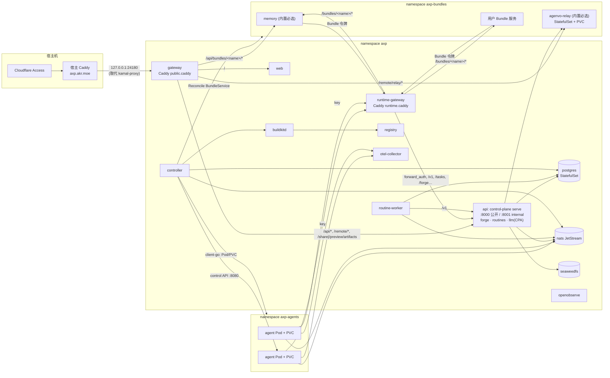

# k3s 部署与 Bundle 服务架构计划

统筹 [#242](https://github.com/AkaraChen/axp/issues/242)（k3s 部署）、[#243](https://github.com/AkaraChen/axp/issues/243)（Bundle 声明 Kubernetes 服务）、[#244](https://github.com/AkaraChen/axp/issues/244)（Memory/Relay 解耦为内置 Bundle）、[#245](https://github.com/AkaraChen/axp/issues/245)（LLM Gateway 合入 control-plane internal）。AXP 任务 #117。**只是计划**：没有安装 k3s，没有改生产、Access 或代码。

基线是合并了 [#241](https://github.com/AkaraChen/axp/issues/241)（PR #246，`d0c1e16`）之后的 main：`api` 角色运行 `axp-control-plane serve`（公开 `:8000` + internal `:8001` 两个 listener），`routine-worker`、`controller` 独立，共 8 个 Kamal 角色。注意生产还跑着 `44f4ca7`（#241 之前的 10 个角色），所以迁移计划假定 #246 先在 Kamal 上线并稳定一段时间。

## 结论先说

1. **先做 #245（LLM 合入 control-plane），不依赖 k3s**，在 Kamal 上就能上线，角色 8→7。它定下了“internal listener 是 Agent 和 Bundle 服务唯一的平台入口”，后面的 Bundle 身份都建在它上面。
2. **k3s 采用干净方案**：Agent 也由 Kubernetes 运行（`container.Driver` 的 Kubernetes 实现），镜像用集群内 BuildKit 构建、推到集群内 registry。不做“核心进 k3s、Agent 仍走宿主 Docker socket”的混合态：那要永久桥接两套网络，NetworkPolicy 管不到 Agent。
3. **Bundle 服务是独立工作负载，不做 sidecar**；每个部署一份，所有载入该 Bundle 的 Agent 共享，按请求里的 `X-AXP-Agent-Id` 区分。control-plane 把每个 Bundle 服务写成一个 `BundleService` 自定义资源（**一个 CRD**，见[要不要用 CRD](#要不要用-crd)），controller 进程里用 controller-runtime 的一个 Reconcile 把它展开成子资源、按 ownerReference 回收、用 kstatus 判就绪；另外发 Bundle 令牌。不做 webhook、多版本转换，Agent 不做成 CRD。
4. **Memory、agenvo relay 变成内置必选 Bundle 的服务**：部署清单从核心部署里移到各自 Bundle 目录，经同一条 Bundle 服务通路上线；路由用约定（`/bundles/<name>/`），新增 Bundle 服务不改网关。
5. **代码量不会在第一阶段下降**。真正删掉的是 Kamal（`deploy.yml`/`deploy.sh` ≈ 660 行 + relay 打包）、llm-gateway 的进程外壳、Docker driver 与 Docker socket；新增的是 Kustomize 清单、Kubernetes driver、`BundleService` CRD 与它的 Reconcile。估算净变化接近持平，换来的是“新增一个服务 = 一个 Bundle 目录”，不再改 9 个地方（[新增服务清单](../architecture/services.md)）。运维上 k3s 本身多一层要升级的东西，这是用户为 Bundle 服务能力付出的真实代价。

## 两种方案比较

|                   | A. 干净：全部进 k3s（推荐）                                                    | B. 最简：核心进 k3s，Agent 仍在宿主 Docker                                              |
| ----------------- | ------------------------------------------------------------------------------ | --------------------------------------------------------------------------------------- |
| Agent 运行        | controller 用 client-go 管 Pod + PVC                                           | controller Pod 挂 `/var/run/docker.sock`，沿用 Docker driver                            |
| 镜像构建          | 集群内 BuildKit（`buildkitd` Deployment），推到集群内 registry                 | 宿主 `docker build`，不变                                                               |
| Agent ↔ 平台网络  | 同一个集群网络，NetworkPolicy 统一管                                           | Docker 网络 → 集群：runtime-gateway/NATS/otel 要用 hostPort/NodePort 暴露给 Docker 网络 |
| Bundle 服务可达性 | Agent 经 runtime-gateway 访问，NetworkPolicy 保证只能这样                      | 同左，但 Agent 不在集群里，隔离靠宿主 iptables，和集群策略是两套                        |
| 新增代码          | k8s driver ≈ 300 行，BuildKit 调用 ≈ 50 行，NetworkPolicy/RBAC YAML            | 几乎没有                                                                                |
| 删除              | Docker driver（309 行）、Docker socket、宿主 build cache（现 45 GB）的手工管理 | 无；Docker 永久保留在生产路径上                                                         |
| 长期              | 一套运行时、一套网络、一套资源/日志模型                                        | 两套运行时永久共存，正是“把 Docker 命令机械换成 YAML”                                   |

B 第一周更快，但它的桥接代码和双网络会一直留着；A 多出来的只有 driver 一个文件，而 `container.Driver` 接口（`List/Run/Start/Remove/Base/ImageTag/HasImage/Build/Prune`）已经把它隔开了。所以推荐 A，渐进体现在“先在同机隔离的 staging 实例上跑通 A 的完整闭环，再切生产”，而不是在生产里留一个混合态。

## 目标拓扑



### 进程与职责

| 工作负载          | 类型                         | 职责                                                                                                                          | 对比现状                                      |
| ----------------- | ---------------------------- | ----------------------------------------------------------------------------------------------------------------------------- | --------------------------------------------- |
| `gateway`         | Deployment                   | 浏览器入口，路由同 [网关](../architecture/gateway.md)，加 `/api/bundles/<name>/*`                                             | 不变；kamal-proxy 由宿主端口直连 Service 取代 |
| `runtime-gateway` | Deployment                   | Agent 与 Bundle 服务的唯一平台入口，`forward_auth` 同时认 Agent key 与 Bundle 令牌；加 `/bundles/<name>/*`                    | 扩展                                          |
| `web`             | Deployment                   | SSR                                                                                                                           | 不变                                          |
| `api`             | Deployment，1 副本，Recreate | `serve`：公开 + internal 两个 listener；#245 后含 CPA（`/api/llm` 在公开，`/v1` 在 internal）；Bundle 令牌签发与 runtime-auth | 吸收 `llm` 角色                               |
| `routine-worker`  | Deployment，1 副本           | 不变；LLM 改为调 `api:8001/v1`                                                                                                | 不变                                          |
| `controller`      | Deployment，1 副本           | Agent Pod/PVC、镜像构建、派发、事件导入；**新增**：Bundle 服务 apply/prune/状态                                               | Docker → client-go                            |
| `buildkitd`       | Deployment，1 副本           | Agent 镜像构建（rootless 优先，不行则 privileged，只有它）                                                                    | 取代宿主 Docker BuildKit                      |
| `registry`        | Deployment + PVC             | 应用镜像、Agent 镜像、Bundle 服务镜像；k3s `registries.yaml` 指向它                                                           | 取代 `axp-registry` 容器                      |
| 基础设施          | StatefulSet + PVC            | postgres(pgvector)、nats、seaweedfs、openobserve、otel-collector                                                              | Kamal accessory → StatefulSet，同镜像同数据   |
| Bundle 服务       | 由 Bundle YAML 决定          | memory、agenvo-relay、用户的                                                                                                  | 新能力；memory、relay 从核心部署移出          |

控制面的 `api` 带两个 RWO 卷（`axp-forge`、`axp-llm` 凭据目录），所以单副本、`Recreate`。这和现在 Kamal 的行为一致（SSE 断开后靠 `Last-Event-ID` 重连）。把这两份凭据移进数据库可以让 `api` 无状态，但不是本计划的前提，列为后续可选。

### namespace 与访问边界

| namespace     | 内容           | NetworkPolicy（k3s 默认带 kube-router 的策略控制器）                                                                                                                            |
| ------------- | -------------- | ------------------------------------------------------------------------------------------------------------------------------------------------------------------------------- |
| `axp`         | 核心与基础设施 | `api:8000` 只收 `gateway`；`api:8001` 只收 `runtime-gateway`、`routine-worker`、`controller`；postgres/s3/openobserve 只收 `axp` 内部；nats、otel-collector 额外收 `axp-agents` |
| `axp-agents`  | Agent Pod      | 入站只收 `controller`；出站只到 `runtime-gateway`、`nats`、`otel-collector`、DNS 和公网（排除集群/节点网段）                                                                    |
| `axp-bundles` | Bundle 服务    | 入站只收两个网关、`controller`、`api`（relay 客户端）、同一 Bundle 的 Pod；出站到 `runtime-gateway`、DNS、公网；**不能**直连 `api`、postgres（数据库见下）                      |

这把现在“靠 Docker 网络划边界”的规则原样搬进 NetworkPolicy：服务之间仍然不共享密钥，也不各自鉴权。`main_test.go` 里“两个 listener 各有哪些路由”的检查继续有效。

### 身份与授权

- **Agent**：不变，`<agent>.<HMAC>` key，runtime-gateway `forward_auth` → `X-AXP-Agent-Id`，插件路由按 `?plugin=` 检查。
- **Bundle 服务**：control-plane 为每个声明了 `uses` 的 Bundle 签发 `bundle.<name>.<generation>.<HMAC(AXP_SECRET_KEY, …)>`，写进 `axp-bundles` 里的 Secret `axp-bundle-<name>`（Bundle YAML 用 `envFrom` 引用）。`generation` 存在表里，轮换即撤销，Secret 的哈希写到 Pod template 注解上触发滚动。`runtime-auth` 认出 Bundle 令牌后返回 `X-AXP-Bundle`，只放行 `bundle.json` 的 `uses` 里列出的能力（首批只有 `llm`，即 `/v1/*`），任何 Agent 插件路由、`/forge` 凭据、管理 API 都不放行。所以“在集群里”本身不给任何权限。
- **用量归属**：memory 抽取要记在对应 Agent 名下。Bundle 令牌带 `llm` 能力时允许在 `X-AXP-Agent-Id` 里写归属，网关另加 `X-AXP-Bundle` 一起记账。这是**归属**，不是授权；Bundle 是管理员安装的受信配置，伪造归属的后果只是用量统计不准。将来要接不受信的第三方 Bundle 时，再改为 runtime-gateway 在转发给 Bundle 时附带短时委托令牌——现在不做。
- **浏览器 → Bundle 服务**：公开网关 `/api/bundles/<name>/*`、runtime-gateway `/bundles/<name>/*`，服务按前缀区分“用户”和“Agent”，与 memory 现在的 `/api/memory` / `/memory` 相同。两个网关都删客户端的 `X-AXP-*`。Bundle 不能自己声明公开（Access 放行）路径；relay 的 `/remote/relay/` 是内置例外，写在 `public.caddy` 里。

## k3s 与镜像/运行时

k3s 默认 containerd，宿主 Docker 的镜像 kubelet 看不到，`docker build` 的结果不能直接用。

- **构建**：controller 的 `Build(dir, tag)` 现在 exec `docker build`；改为 exec `buildctl --addr tcp://buildkitd:1234 build --frontend dockerfile.v0 … --output type=image,name=<registry>/axp-agent:<hash>,push=true`（controller 镜像带 `buildctl`，约 50 行改动）。Dockerfile 生成逻辑、内容摘要、构建失败回显都不变。BuildKit 缓存在它自己的 PVC，设 `gckeepstorage` 上限（现在宿主 build cache 有 45 GB，从未限制过）。
- **分发**：集群内 registry（`registry:3`），k3s `registries.yaml` 把 `registry.axp.svc:5000` 映射到 NodePort/hostPort `127.0.0.1:24150`（与现有保留端口相同），节点拉取不出机器。`HasImage` 改为 registry 的 `HEAD /v2/.../manifests/<tag>`；`Prune` 删除不再引用的 tag，再由每日 CronJob 跑 `registry garbage-collect`。节点上的旧层交给 kubelet 镜像 GC。
- **基础镜像**：`axp-agent-runtime:<环境>` 也推到 registry，`Base()` 返回它的 digest（替代现在的本机镜像 ID）。
- **Agent Pod**：`Run` = 删旧 Pod、建新 Pod（同名 PVC `axp-agent-<id>`，`local-path`），标签带 `axp.dev/agent`、`axp.dev/config`；`restartPolicy: Always` 对应现在的 `unless-stopped`；资源 `limits` 同现在的 2 GiB / CPU；`List` 按标签列 Pod，`URL` 用 Pod IP。用裸 Pod 而不是 Deployment：controller 本来就是这个 reconcile 循环，加一层 Deployment 只会多一个控制器和它自己的滚动语义。
- **开发环境**：`scripts/dev.sh` 现在用 Docker driver。待用户决定（D3）：推荐 dev 也用 k3d（k3s in Docker，无需 root），核心进程仍在宿主机热重载，只有 Agent、Bundle 服务和基础设施在 k3d 里，然后删掉 Docker driver；否则就得永久维护两个 driver 和两种 Bundle 服务运行方式。

## Bundle 服务（#243）

### 形状

```
apps/agent-runtime/bundles/memory/
  bundle.json        # 新增 "service" 段
  service/
    kustomization.yaml
    deployment.yaml
    service.yaml
```

```json
{
  "name": "memory",
  "required": true,
  "plugins": ["memory"],
  "service": {
    "protocol": "axp.memory/1",
    "uses": ["llm"],
    "database": true
  }
}
```

- **YAML 就是普通 Kubernetes/Kustomize**，用户自己写；control-plane 用 `kustomize build`（Go 库 `sigs.k8s.io/kustomize/api`）展开，不发明模板语言。自定义 Bundle 在设置页贴 YAML（存在表 `bundle` 新列）。
- **约定代替配置**：服务必须有一个名为 `<bundle>` 的 Service，端口名 `http`；健康和能力发现走 `GET /.well-known/axp-service`。网关用 Caddy 占位符把 `/bundles/{name}/` 转到 `{name}.axp-bundles.svc:http`，新增 Bundle 不改网关。
- **配置与 Secret**：#233 的 `config` schema 已有；声明了 `service` 的 Bundle，`ready` 的值由 control-plane 写成 Secret `axp-bundle-<name>-config`，YAML 用 `envFrom` 引用。机密不进 prompt、不进 Artifact、不进 Agent 容器（与现在“值注入 Agent 容器”是两条路：服务用的机密走 Secret，给 Agent 自己用的仍注入 Agent）。
- **数据库**：`database: true` 时 control-plane 在共享 postgres 上建库 `axp_bundle_<name>` 和同名角色，连接串写进 Secret。只有一个 PostgreSQL 要备份。Bundle 也可以自带 StatefulSet——那是它自己的事，平台不管它的备份。

### 独立工作负载，不做 sidecar

- sidecar 要改 Agent Pod 的 spec，等于改 Agent 的 `config` 摘要，每次 Bundle 服务升级都替换所有载入它的 Agent，而且每个 Agent 一份实例（memory 每份 850 MB，见下文资源）。
- 独立工作负载：**每个部署一份**，被所有载入它的 Agent 共享，服务自己按 `X-AXP-Agent-Id` 隔离（memory 已是如此）。不支持“每 Agent 一份”和“每实例一份”；确实需要时 Bundle 自己按 Agent 分区。

### control-plane 真正要管的

| 管                                                                                                | 不管（交给 Kubernetes/现成库）                                       |
| ------------------------------------------------------------------------------------------------- | -------------------------------------------------------------------- |
| 期望状态：`api` 把 Bundle 的服务写成 `BundleService`（来源仍是镜像里的内置 Bundle 和表 `bundle`） | 滚动、重启、调度、探针：Deployment/kubelet                           |
| Reconcile：展开子资源、server-side apply、删除不再声明的子资源                                    | 删除整个 Bundle 时的级联回收：ownerReference + 垃圾回收器            |
| Bundle 令牌、配置 Secret、数据库角色                                                              | 就绪判断：kstatus（`sigs.k8s.io/cli-utils/pkg/kstatus`，只用这个库） |
| 状态写在 `BundleService.status.conditions`，`api` 只读它给 Web                                    | 资源配额：namespace 的 `ResourceQuota`/`LimitRange`                  |

- RBAC：controller 的 ServiceAccount 在 `axp-bundles` 只有一个 Role，kind 白名单：Deployment、StatefulSet、Service、ConfigMap、Secret、PVC、Job、CronJob、ServiceAccount，加上 `bundleservices` 及其 `status`。没有 ClusterRole、没有 RBAC 对象、没有其他 namespace；`api` 只能读 `bundleservices`。`axp-bundles` 打 Pod Security `baseline`。用户 YAML 里出现白名单外的 kind 或别的 namespace 时整个 Bundle 报错（`Applied=False`），不部分应用。
- 卸载/升级：子资源带 ownerReference，删掉 `BundleService` 即级联删除工作负载；**PVC 不挂 ownerReference，数据库角色也不随之删除**，默认保留，设置里另有“删除数据”按钮。
- 外部端点：`spec.external: "https://…"` 时不展开 YAML，只建一个 ExternalName Service，其余契约相同。

### 要不要用 CRD

用户在 PR 审阅时问：走 CRD 会不会让实现更可控、实现方更好写。结论是**会，但只用在 Bundle 服务这一处**，而且只是一个 CRD 加一个 Reconcile，不是 Operator 框架。

```yaml
apiVersion: axp.dev/v1alpha1
kind: BundleService
metadata: { name: memory, namespace: axp-bundles }
spec:
  revision: 3f2a… # YAML + 配置 + 令牌 generation 的摘要
  protocol: axp.memory/1
  uses: [llm]
  database: true
  external: "" # 可选：外部端点，不部署
  manifests: | # kustomize build 的结果
    apiVersion: apps/v1
    kind: Deployment
    …
status:
  observedGeneration: 4
  conditions: [Applied, Ready, Compatible] # 标准 metav1.Condition
  version: 1.4.0
  capabilities: [mcp, capture, recall]
```

|                    | 不用 CRD（原稿：cli-utils applier + 状态表）                                       | 一个 CRD + controller-runtime（推荐）                                                                     |
| ------------------ | ---------------------------------------------------------------------------------- | --------------------------------------------------------------------------------------------------------- |
| 期望状态与实际状态 | 摘要和状态在 PostgreSQL 的状态表里，实际资源在集群里，两边对账靠 controller 自己写 | 期望在 `spec`，结果在 `status`，同一个对象；`kubectl get bundleservices` 就能看全部状态                   |
| 触发方式           | 跟着 controller 的 tick 轮询                                                       | watch：`BundleService` 改了、它拥有的 Deployment/StatefulSet 状态变了就入队，失败自动退避重试             |
| 回收               | 每个 Bundle 一个 inventory ConfigMap，靠 cli-utils 做差集删除                      | 删除整个 Bundle：ownerReference 级联；只删了 YAML 中的某个对象：按标签列出白名单 kind 后删差集（≈ 30 行） |
| 并发与冲突         | 自己保证同一时刻只有一个 controller 在 apply                                       | 工作队列保证同一对象不会并发 Reconcile；乐观并发冲突自动重试                                              |
| 测试               | 要模拟 cli-utils 和数据库                                                          | `envtest`（真实 kube-apiserver，无节点）测 Reconcile 的输入输出；单元测试用 fake client                   |
| 排查               | 看 controller 日志和状态表                                                         | `kubectl describe bundleservice memory`：conditions 与 Events                                             |
| 估算代码           | applier 胶水 ≈ 300 行 + 状态表迁移与读写 ≈ 150 行                                  | 类型 ≈ 80 行（deepcopy 与 CRD YAML 由 controller-gen 生成）+ Reconcile ≈ 250 行                           |

为什么实现方更好写：Reconcile 是一个纯函数式的契约——“给定这个 `BundleService`，让集群收敛到它，并写回 status”，幂等、可重入，不用关心是谁、何时、改了几次。重启、重复提交、半途失败都由同一条路径处理，这正是原稿里要单独保证的“重启不重复创建”。可控体现在三处：期望/结果都在一个可读的对象上；Bundle 的作者能用 `kubectl` 自己看自己的服务为什么没就绪；回收由 Kubernetes 的垃圾回收器完成，不是我们自己的差集代码。

边界，避免它长成 Operator：

- **只有一个 kind，`v1alpha1`，只加字段不改字段**，所以不需要转换 webhook；校验用 CRD 自带的 OpenAPI/CEL 规则，不写准入 webhook。
- **它是投影，不是来源**。Bundle 的定义、配置（加密）和令牌 generation 仍在 PostgreSQL 和镜像里；`api` 在保存时用 server-side apply 写 `spec`（字段属主 `axp-api`），controller 启动时为内置 Bundle 补齐。手工 `kubectl edit spec` 会被下一次保存覆盖，文档写明。这样不出现两份真相，也不需要把数据库迁到 etcd。
- **Reconcile 在现有的 `controller` 进程里**，controller-runtime 的 manager 关掉它自己的 leader election，在 controller 拿到现有的 advisory lock 之后才启动，所以不新增进程，也不出现两把锁。
- **Agent 不做成 CRD**：Agent 的期望状态和对话锁、派发、忙闲判断在同一个数据库事务里，镜像到 CR 只会多一份需要同步的状态。Agent 继续由现有 tick 通过 `container.Driver` 管 Pod，以后若 tick 里的 Kubernetes 部分变复杂再评估。

不选的现成 CRD：k3s 自带的 `HelmChart`（helm-controller）要把用户 YAML 打成 chart，每次变更起一个 Job 跑 helm，状态只有 Job 成败，没有就绪；Flux 的 `Kustomization` 功能对得上，但要引入整套 Flux（源控制器、多个 CRD、自己的升级周期），对单节点自托管过重。

代价：controller 的依赖增加 controller-runtime（client-go 本来就要引入）；部署要先装 CRD 再起 controller（放在同一份 Kustomize base 里，`kubectl apply -k` 保证 CRD 先建）；dev 也需要一个 API server，这让 D3（dev 用 k3d）从“推荐”变成“基本必须”。

必选 Bundle 的服务不健康时，载入它的 Agent 照常运行，相关插件路由返回 503 `BUNDLE_SERVICE_UNAVAILABLE`，Web 在设置和 Agent 页显示状态——不静默移除功能，也不让整个 control-plane 不就绪。

## Memory 与 Relay 解耦（#244）

|            | Memory                                                                                                                                 | agenvo relay                                                                                                             |
| ---------- | -------------------------------------------------------------------------------------------------------------------------------------- | ------------------------------------------------------------------------------------------------------------------------ |
| Bundle     | `memory`（已是 `required: true`）                                                                                                      | `agenvo`（改为 `required: true`，需用户确认 D5）                                                                         |
| 工作负载   | Deployment 1 副本                                                                                                                      | StatefulSet 1 副本 + PVC（SQLite，只能单进程）                                                                           |
| 镜像       | `axp-memory:<版本>`，自己的 Dockerfile（今天它挤在统一应用镜像里，靠 `PYTHONPATH` 选进程）                                             | `axp-relay:<agenvo 版本>`，即现在的 `relay.Dockerfile`                                                                   |
| 协议       | `axp.memory/1`：MCP、`/capture`、`/recall`、`/api/.../memories`                                                                        | `agenvo.relay/<agenvo 主版本>`：管理 API、MCP、配对、`/remote/relay` 公开路由                                            |
| 数据       | 现在在主库 `axp` 的 `memories` 表 → 迁到 `axp_bundle_memory`（一次性 Job：`pg_dump -t memories` → restore，校验行数，旧表保留到 D+14） | 卷 `axp-relay` 的内容复制进 PVC（Job 用 `tar`），保留设备配对和 OAuth 授权                                               |
| 核心的依赖 | 无代码依赖（只有网关路由），无需客户端                                                                                                 | `internal/relay` 客户端（618 行）留在 control-plane：它是远程电脑功能的使用方，只是地址和管理员密钥改从 Bundle Secret 读 |

- **能力发现**：`/.well-known/axp-service` 返回 `{protocol, version, capabilities}`。controller 在服务 `ready` 后读一次，与 `bundle.json` 的 `protocol` 主版本比较，不兼容则 `incompatible`。relay 额外返回 agenvo 版本，control-plane 在下发 connector 安装命令前比较 connector 的期望版本，不兼容时在远程电脑页显示“需更新 connector”，与现在 agenvo 从固定 SHA 构建（PR #225）配套。
- **独立发布**：服务镜像不再要求与 control-plane 同源码同次构建。仓库里仍保留 `apps/memory-service`、`apps/agenvo`，但它们的镜像由各自的 Turbo 任务构建，Bundle YAML 里的 `image:` 由构建写入（kustomize `images:`）。#116（Python 遥测内聚到 memory-service）已取消：memory 镜像的构建上下文继续包含 `packages/telemetry-py`，若以后重开 #116，只改这个镜像的 Dockerfile，不影响本计划。
- **必选但可配置**：配置照 #233 的 schema 表单（例如 memory 的召回条数）；没有“关闭”开关。
- **回滚**：旧表、旧卷在切换后保留 14 天；回滚 = 网关路由指回旧服务 + 旧表仍在。

## LLM Gateway 合入 control-plane（#245）

- **进程内集成**：`cliproxy.Service.Run` 自己起 HTTP server。第一步审计 CPA SDK 能否只拿到它的 `http.Handler`/gin 引擎而不让它监听（`sdk/api` 的 server 构造），能则把 `/api/llm/*`（管理）挂到公开 listener、`/v1/*`（推理）挂到 internal listener；不能则 CPA 只监听 `127.0.0.1` 随机端口，两个 listener 在进程内反代过去——这是实现细节，不对外暴露，不算新服务，但要在 PR 里说明。CPA 的全局注册表决定了一个进程只能有一份：只有 `serve` 带它，`routine-worker` 走 `api:8001/v1`。
- **readiness**：`api` 就绪只看两个 listener，CPA 上游、某个模型的故障只反映在模型目录的状态里。
- **数据**：卷 `axp-llm` 改挂到 `api`（路径不变，`usage.json`、`models.json`、auths 原样），与 #241 处理 `axp-forge` 的方式相同。
- **删除**：`apps/llm-gateway/main.go` 的进程外壳、它的 Go 模块（`internal/*` 搬成 control-plane 的 `internal/llm*` 包）、`llm` 角色、`AXP_LLM_GATEWAY_URL`（control-plane 自己的 HTTP client 改为模块调用）、网关的 `AXP_UPSTREAM_LLM`。`contract_test.go` 原样保留。
- **在 Kamal 上做**：不等 k3s，Kamal 角色 8→7。

## 单节点自托管默认部署

- **安装**：`deploy/k3s/` 一个 Kustomize base + `overlays/production`。k3s 用 `--disable traefik --disable servicelb`（不用它们，入口仍是宿主 Caddy）、`--write-kubeconfig-mode 600`。`deploy/k3s/install.sh` 只做：检查 k3s、写 `registries.yaml`、从 `~/.config/axp/production.env` 生成 Secret（`kubectl create secret … --dry-run=client -o yaml | kubectl apply`）、`kubectl apply -k`、跑迁移 Job、等 rollout。目标 ≤ 150 行（现在 `deploy.sh` 328 行，多数是 Kamal 和 SSH 回环的准备）。不用 Helm：只有一个环境，Kustomize 内置在 kubectl 里，不需要 values 模板。
- **入口**：`gateway` 的 Service 用 hostPort/NodePort 绑在 `127.0.0.1:24180`，宿主 Caddy 与 Cloudflare Access 配置**不变**；`/remote/`、`/share/artifacts/`、`/preview/artifacts/` 的 Access 放行不变。kamal-proxy 退役。
- **存储**：k3s 自带 `local-path`，PVC 名与现在的 Docker 卷名一一对应（`axp-postgres`、`axp-nats`、`axp-objects`、`axp-forge`、`axp-llm`、`axp-relay`、`axp-openobserve`、`axp-agent-<id>`）。PV 回收策略改为 `Retain`。
- **备份**：CronJob 每日 `pg_dumpall` + `local-path` 目录的 restic 快照（或 tar）到 `~/axp-backups`，保留 7 天；恢复步骤写进 README 并在 staging 演练一次。这是现在没有的。
- **迁移 Job**：每次部署先跑 `axp-control-plane migrate` 的 Job（新镜像），成功后再更新 Deployment 镜像；失败则停止部署，旧版本继续运行。
- **readiness/OTel**：Kamal 的 Docker 健康检查改成 `readinessProbe`（`api` 两个 listener 各一个 httpGet）；`OTEL_SERVICE_NAME` 不变，`service.version` 改由镜像 tag（git commit）注入；otel-collector、openobserve 原样。
- **更新与回滚**：镜像 tag = git commit；回滚 = 用上一个 tag 再 `kubectl apply -k`（迁移是前向兼容的，与现在的约定相同）。不用 `kubectl rollout undo`，因为它只回滚单个 Deployment。
- **资源**（生产当前实测，`docker stats`，#241 之前）：核心角色合计约 0.35 GiB，memory 0.85 GiB，postgres/nats/s3/openobserve/otel/relay 合计约 0.7 GiB，Agent 每个 0.06–0.5 GiB；宿主 8 核 / 16 GiB，已用 9 GiB。k3s server + containerd 约 0.5–0.8 GiB，buildkitd 空闲约 0.1 GiB。切换期两套并存时内存最紧，所以 staging 不复制 memory 的数据和 Agent，只跑一个测试 Agent。

## 从 Kamal 迁移

| 阶段 | 内容                                                                                                                                                                                    | 生产影响                                     | 退出/通过条件                                                                                              |
| ---- | --------------------------------------------------------------------------------------------------------------------------------------------------------------------------------------- | -------------------------------------------- | ---------------------------------------------------------------------------------------------------------- |
| 0    | #246 在 Kamal 上线并稳定；#245 实施并在 Kamal 上线（7 角色）                                                                                                                            | 正常部署                                     | 一周无回滚                                                                                                 |
| 1    | `deploy/k3s/` 清单 + Kubernetes driver + BuildKit 构建；在本机装 k3s，部署 **staging** 实例（独立 namespace 前缀、空库、独立端口、不接 Access）                                         | 无（只多占内存；k3s 不碰 Docker 的容器和卷） | 新装、Agent 构建/启动/重建、聊天、任务、定时、Artifacts、远程连接、重启恢复、升级、回滚全部在 staging 走通 |
| 2    | Bundle 服务通路（#243）+ memory、relay 改为 Bundle 服务（#244），先在 staging                                                                                                           | 无                                           | memory 召回/保存、Web 记忆页、relay 配对与 connector 更新在 staging 正常；Bundle 令牌只能调 `/v1`          |
| 3    | 切生产：停 Kamal 写入（`kamal app stop`，accessory 保持）→ `pg_dumpall` + 卷 tar 快照 → 数据导入 k3s PVC（Job）→ 部署 → 宿主 Caddy upstream 不变（同端口 24180）→ 验收                  | 停机约 10–20 分钟                            | 验收清单全过                                                                                               |
| 4    | 观察 7 天：Kamal 容器停着不删，卷不删                                                                                                                                                   | —                                            | 7 天无回滚                                                                                                 |
| 5    | 删除：`deploy/deploy.yml`、`deploy.sh` 的 Kamal 部分、`relay.Dockerfile` 的 Kamal 打包、kamal-proxy、`axp-registry` 容器、Docker driver（D3 决定 dev 后）、旧 Docker 卷（备份留 30 天） | —                                            | 仓库里没有 Kamal 和 Docker socket 引用                                                                     |

阶段 3 的回滚：k3s 停掉 `gateway`（释放 24180），`kamal app boot`，Kamal 读的仍是原来的 Docker 卷（阶段 3 只是**复制**进 PVC，不移动），损失切换后写入的数据——所以阶段 4 内回滚需要先把 k3s 的库导回，README 里写清楚。密钥：`production.env` 仍是唯一来源，`AXP_SECRET_KEY` 必须原样带过去（Agent key、Bundle 配置的加密都由它派生）。NATS：JetStream 流 `ROUTINES` 和 runtime 事件随卷复制；流里未消费的 runtime 事件在停机前排空。

## 实施拆分

| # | 内容                                                                                                                                                                                         | 依赖      | 验收                                                                                                               |
| - | -------------------------------------------------------------------------------------------------------------------------------------------------------------------------------------------- | --------- | ------------------------------------------------------------------------------------------------------------------ |
| 1 | #245 LLM 合入 control-plane（含 CPA handler 审计）                                                                                                                                           | #246 上线 | 真实流式请求、取消、OAuth 登录、模型目录、用量、`contract_test`；Kamal 7 角色                                      |
| 2 | `deploy/k3s` Kustomize 清单 + install 脚本 + NetworkPolicy/RBAC + 迁移 Job + 备份 CronJob                                                                                                    | 1         | staging 新装、升级、回滚、重启恢复；策略测试（Agent Pod 连不到 `api:8000`/postgres，Bundle Pod 连不到 `api:8001`） |
| 3 | Kubernetes driver + BuildKit 构建 + registry prune；dev 方案（D3）                                                                                                                           | 2         | Agent 构建、重建、空闲替换、PVC 保留、镜像清理                                                                     |
| 4 | Bundle 服务：`service` 段、kustomize 展开、`BundleService` CRD 与 Reconcile（ownerReference、白名单差集删除、kstatus）、Bundle 令牌与 `runtime-auth`、配置 Secret、数据库供给、Web 读 status | 3         | envtest 覆盖重复提交、半途失败、删除子对象、卸载保留 PVC、越权 kind 拒绝；令牌撤销立即生效                         |
| 5 | memory、relay 改为内置 Bundle 服务；数据迁移 Job；能力发现                                                                                                                                   | 4         | memory 数据行数一致；relay 设备与授权保留；connector 版本检查                                                      |
| 6 | 生产切换、观察、删除 Kamal                                                                                                                                                                   | 5         | 上表阶段 3–5                                                                                                       |

1 可以立即开始；2–5 在 staging 上推进，不影响生产；6 需要用户另行批准。

## 代码与运维的真实账

|             | 删除                                                                                                                         | 新增（估算）                                                |
| ----------- | ---------------------------------------------------------------------------------------------------------------------------- | ----------------------------------------------------------- |
| #245        | llm-gateway 进程外壳与 Go 模块样板、control-plane 的 LLM HTTP client、一个角色、一个 upstream 变量（业务代码只是搬家，不计） | CPA 挂载 ≈ 100 行                                           |
| 部署        | `deploy.yml` 331、`deploy.sh` ≈ 250、relay 打包、kamal-proxy、registry 容器、SSH 回环                                        | Kustomize ≈ 500–700 行 YAML、install ≈ 150                  |
| 运行时      | Docker driver 309（D3 后）、Docker socket 挂载                                                                               | k8s driver ≈ 300、buildctl ≈ 50、prune ≈ 50                 |
| Bundle 服务 | memory、relay 在部署里的专属段落；“新增服务清单”里的大部分步骤                                                               | CRD 类型与 Reconcile/令牌/数据库 ≈ 450–600 行 Go + Web 状态 |

净行数大约持平或略增；减少的是**机制**：特殊服务的部署段落和网关路由被一条通用通路取代，Docker 退出生产路径。运维上多了 k3s 本身（版本升级、证书自动轮换、kine/SQLite 状态），少了 Kamal 的 SSH 回环、registry 与 proxy。若用户只看“代码行数”，这个计划不划算；它的收益是 Bundle 能带服务这一能力，以及之后每个新服务的边际成本接近零。

## 待用户决定

| #  | 问题                                                                | 默认（不回复则按此推进）                                         |
| -- | ------------------------------------------------------------------- | ---------------------------------------------------------------- |
| D1 | 是否接受方案 A（Agent 也进 k3s，Docker 退出生产）                   | 接受                                                             |
| D2 | 先做 #245（在 Kamal 上），再开始 k3s                                | 是                                                               |
| D3 | dev 也迁到 k3d 并删 Docker driver，还是 dev 永久保留 Docker driver  | k3d，删 Docker driver（用 CRD 后 dev 也要 API server，基本必须） |
| D4 | Bundle 服务的数据库：平台在共享 PostgreSQL 上供给，还是 Bundle 自带 | 平台供给                                                         |
| D5 | `agenvo` Bundle 改为必选（relay 是内置不可关闭插件）                | 必选                                                             |
| D6 | memory 数据从主库 `memories` 表迁到独立库                           | 迁（旧表留 14 天）                                               |
| D7 | 生产切换的停机窗口（约 10–20 分钟）和时间                           | 需要用户指定                                                     |
| D8 | 是否新增每日备份 CronJob 与备份位置                                 | 新增，`~/axp-backups`                                            |

可以按默认推进的：namespace 划分、Kustomize 而非 Helm、Bundle 服务用一个 `BundleService` CRD（Agent 不用）、Bundle 服务的命名/端口/发现约定、PVC 名与现有卷同名、`Retain` 回收、镜像 tag 用 commit。
