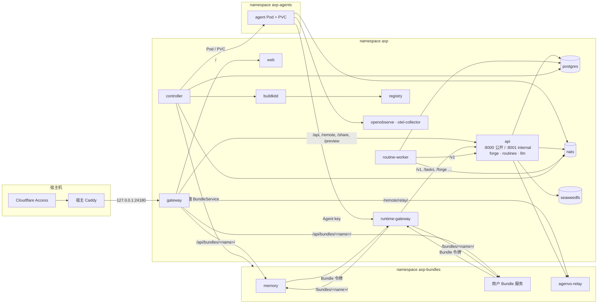

# k3s 部署与 Bundle 服务：架构

本文描述目标架构，覆盖 [#242](https://github.com/AkaraChen/axp/issues/242)（k3s 部署）、[#243](https://github.com/AkaraChen/axp/issues/243)（Bundle 服务）、[#244](https://github.com/AkaraChen/axp/issues/244)（Memory/Relay 内置 Bundle）、[#245](https://github.com/AkaraChen/axp/issues/245)（LLM 合入 control-plane）。怎么从现状走到这里，见[实现文档](implementation.md)。

## 概览

- AXP 跑在单节点 k3s 上：核心、基础设施、Agent、Bundle 服务分别在三个 namespace。
- control-plane 仍是一个二进制、三个进程：`api`（公开 + internal 两个 listener，含 forge、routines、LLM）、`routine-worker`、`controller`。
- Agent 由 `controller` 直接管理 Pod 和 PVC；镜像由集群内 BuildKit 构建，存在集群内 registry。
- Bundle 除了脚本和插件，还能带 Kubernetes YAML 声明服务。每个 Bundle 服务是一个 `BundleService` 自定义资源，由 `controller` 调谐成普通工作负载。
- memory 和 agenvo relay 是内置、必选的 Bundle 服务，与用户 Bundle 走同一条通路。
- 信任边界由 NetworkPolicy 划定；Agent 和 Bundle 服务都只能经 `runtime-gateway` 进入平台，按各自的身份授权。

## 工作负载

| 工作负载          | 类型                                  | 职责                                                                                                                                                   |
| ----------------- | ------------------------------------- | ------------------------------------------------------------------------------------------------------------------------------------------------------ |
| `gateway`         | Deployment                            | 浏览器入口（`public.caddy`），路由见下文                                                                                                               |
| `runtime-gateway` | Deployment                            | Agent 与 Bundle 服务进入平台的唯一入口（`runtime.caddy`），`forward_auth` 认 Agent key 和 Bundle 令牌                                                  |
| `web`             | Deployment                            | SSR 与静态资源                                                                                                                                         |
| `api`             | Deployment，1 副本，`Recreate`        | `axp-control-plane serve`：公开 listener `:8000`、internal listener `:8001`；含 forge、routines 管理、LLM（CPA）；签发 Bundle 令牌；写 `BundleService` |
| `routine-worker`  | Deployment，1 副本                    | 定时任务的执行、恢复、修订；LLM 经 `api:8001/v1`                                                                                                       |
| `controller`      | Deployment，1 副本                    | Agent 的镜像、Pod、派发与事件导入；调谐 `BundleService`；advisory lock 保证同时只有一个                                                                |
| `buildkitd`       | Deployment，1 副本 + PVC              | 构建 Agent 镜像，缓存有上限                                                                                                                            |
| `registry`        | Deployment + PVC                      | 应用、Agent、Bundle 服务的镜像                                                                                                                         |
| `postgres`        | StatefulSet + PVC                     | PostgreSQL 17 + pgvector：`axp`、`axp_routines`，以及各 Bundle 服务的库                                                                                |
| `nats`            | StatefulSet + PVC                     | JetStream：runtime 事件、定时任务计划                                                                                                                  |
| `seaweedfs`       | StatefulSet + PVC                     | Artifact 的 S3（也可换外部 S3）                                                                                                                        |
| `openobserve`     | StatefulSet + PVC                     | 日志与 trace                                                                                                                                           |
| `otel-collector`  | Deployment                            | 无凭据的 OTLP 入口，给 Agent 用                                                                                                                        |
| Agent             | Pod + PVC，`axp-agents`               | 每个 Agent 一个，由 `controller` 管                                                                                                                    |
| Bundle 服务       | 由 Bundle 的 YAML 决定，`axp-bundles` | memory、agenvo-relay、用户的                                                                                                                           |

`api` 持有两个 RWO 卷（GitHub App 凭据 `axp-forge`、模型账号凭据 `axp-llm`），所以单副本、先停后起。SSE 连接在重启时断开，浏览器带 `Last-Event-ID` 重连。

## 网络与信任边界

| namespace     | 入站                                                                                                                                                              | 出站                                                                         |
| ------------- | ----------------------------------------------------------------------------------------------------------------------------------------------------------------- | ---------------------------------------------------------------------------- |
| `axp`         | `api:8000` 只来自 `gateway`；`api:8001` 只来自 `runtime-gateway`、`routine-worker`、`controller`；`nats`、`otel-collector` 另收 `axp-agents`；其余只收 `axp` 内部 | 不限                                                                         |
| `axp-agents`  | 只来自 `controller`（runtime 控制接口 `:8080`）                                                                                                                   | `runtime-gateway`、`nats`、`otel-collector`、DNS、公网（排除集群和节点网段） |
| `axp-bundles` | 两个网关、`controller`、`api`（relay 客户端）、同一 Bundle 的 Pod                                                                                                 | `runtime-gateway`、DNS、公网                                                 |

NetworkPolicy 由 k3s 自带的策略控制器执行。服务之间不共享密钥，也不各自鉴权：能连到一个端口的只有该连的调用方。`api` 的 runtime 路由只在 internal listener 上，`gateway` 只连公开 listener。

## 身份与授权

| 调用方           | 凭据                                                               | 网关注入                           | 能访问                                                                                            |
| ---------------- | ------------------------------------------------------------------ | ---------------------------------- | ------------------------------------------------------------------------------------------------- |
| 浏览器           | Cloudflare Access（外层）                                          | `X-Request-Id`；删掉所有 `X-AXP-*` | 公开 listener、`/api/bundles/<name>/`                                                             |
| Agent            | `<agent>.<HMAC(AXP_SECRET_KEY)>`                                   | `X-AXP-Agent-Id`、`X-AXP-Group-Id` | `/v1`；它的 Bundle 带来的插件路由；`/forge` 凭据；`/bundles/<name>/`（需载入该 Bundle）           |
| Bundle 服务      | `bundle.<name>.<generation>.<HMAC>`，在 Secret `axp-bundle-<name>` | `X-AXP-Bundle`                     | 只有 `bundle.json` 的 `uses` 里声明的：`llm`（`/v1`），或其他 Bundle 的名字（`/bundles/<name>/`） |
| `routine-worker` | 无（网络可达即可）                                                 | —                                  | `api:8001/v1`，以 `routine-<id>` 记账                                                             |

- `runtime-gateway` 对每个请求先问 `api` 的 `GET /internal/v1/runtime-auth`，带上路由所需的插件或能力；不通过就把 403 原样返回。
- Bundle 令牌的 `generation` 存在数据库里，轮换即撤销；`controller` 把新令牌写进 Secret，并把它的摘要写到 Pod template 注解上，服务随之滚动。
- 用量归属：Bundle 带 `llm` 能力调用 `/v1` 时可以在 `X-AXP-Agent-Id` 里写明记在哪个 Agent 名下（memory 抽取用的就是该 Agent 的模型）；网关同时记下 `X-AXP-Bundle`。这是记账字段，不授予任何 Agent 的权限。
- 在集群里本身不给任何权限：没有令牌的 Bundle Pod 只能连到 `runtime-gateway`，被拒绝。

## Agent 运行时

`controller` 的 tick 循环不变：它从数据库算出每个 Agent 期望的镜像和容器 spec，通过 `container.Driver` 收敛。Kubernetes 实现：

| Driver 方法          | 实现                                                                                                               |
| -------------------- | ------------------------------------------------------------------------------------------------------------------ |
| `Run`                | 删旧 Pod，建新 Pod：镜像、环境变量、资源上限（2 GiB）、PVC `axp-agent-<id>` 挂在 `/agent`，`restartPolicy: Always` |
| `List`               | 按标签 `axp.dev/agent` 列 Pod，`URL` 用 Pod IP 的 `:8080`                                                          |
| `Start` / `Remove`   | 删 Pod 由下一轮重建 / 删 Pod，PVC 保留                                                                             |
| `Base`               | registry 中 `axp-agent-runtime:<环境>` 的 digest                                                                   |
| `Build`              | `buildctl` 调用 `buildkitd`，推送 `registry/axp-agent:<内容摘要>`；失败返回输出末尾                                |
| `HasImage` / `Prune` | registry 的 manifest 查询 / 删除不再引用的 tag，每日 CronJob 做 registry GC                                        |

Agent 的 Dockerfile、内容摘要、空闲时替换、构建失败显示都与现在相同。Agent 用裸 Pod：`controller` 本身就是它的调谐器。k3s 的 `registries.yaml` 让节点从集群内 registry 拉镜像。

## Bundle 服务

已实现，规范见[环境包的服务](../../architecture/bundles.md#服务)。要点：

- Bundle 的 `service/*.yaml` 是普通 Kubernetes YAML（自定义 Bundle 存在表 `bundle`），`bundle.json` 的 `service` 声明 `protocol`、`uses`、`database`。只允许白名单 kind，不能写命名空间。
- 约定：与 Bundle 同名、端口名 `http` 的 Service；智能体经 runtime 网关 `/bundles/<name>/x`（服务收到 `/<name>/x`），用户经公共网关 `/api/bundles/<name>/x`（服务收到 `/api/<name>/x`）。网关用路径里的名字找 Service，新增服务不改网关。
- 每个 Bundle 一个 `BundleService`（CRD，`spec` 是清单与摘要，`status` 是 `applying`/`ready`/`incompatible`/`error`）。controller 每 5 秒按 Bundle 目录调谐：写 Secret `axp-<name>`（网关地址、令牌、数据库、配置……）和清单里的对象（server-side apply，ownerReference 指向 `BundleService`，Pod 模板带版本摘要），删掉清单里没有了的对象，读 kstatus 式的就绪和 `/.well-known/axp-service`。删 `BundleService` 由 Kubernetes 级联删除，PVC 与数据库保留。
- 与计划的差别：没有用 controller-runtime，也没有 watch：controller 已有循环和 advisory lock，一个 5 秒的周期调谐（摘要不变时只是幂等的 apply）就够了，少一个依赖和一套事件机制；状态是一个 `state` 加 `message`，不是多个 conditions；`external`（外部端点）没有做，需要时再加。
- 权限：controller 的 ServiceAccount 只在 `<ns>-agents`、`<ns>-bundles` 有 Role（`deploy/k3s/workloads.yaml`），API 只能读 `bundleservices`。

## 内置 Bundle 服务

|          | memory                                                        | agenvo-relay                                                                                               |
| -------- | ------------------------------------------------------------- | ---------------------------------------------------------------------------------------------------------- |
| Bundle   | `memory`，必选                                                | `agenvo`，必选                                                                                             |
| 工作负载 | Deployment 1 副本                                             | StatefulSet 1 副本 + PVC（SQLite）                                                                         |
| 镜像     | `axp-memory:<版本>`，独立构建                                 | `axp-relay:<agenvo 版本>`，从固定的 agenvo 提交构建                                                        |
| 协议     | `axp.memory/1`：MCP、`/capture`、`/recall`、记忆管理接口      | `agenvo.relay/<主版本>`：管理 API、MCP、配对                                                               |
| 数据     | 库 `axp_bundle_memory`（表 `memories`，pgvector）             | PVC：设备配对与 OAuth 授权                                                                                 |
| 平台依赖 | `uses: [llm]`：用 Agent 自己的模型抽取事实                    | 无                                                                                                         |
| 谁调用   | Agent（`/bundles/memory/`）、浏览器（`/api/bundles/memory/`） | 远程电脑的 connector（`/remote/relay/`）；`api` 的 relay 客户端（管理员密钥在 `axp-bundle-agenvo-config`） |

- 两者都没有“关闭”开关；配置用 Bundle 的 `config` schema 表单。
- relay 的 `/.well-known/axp-service` 额外返回 agenvo 版本；`api` 下发 connector 安装命令前与 connector 的期望版本比较，不兼容时在远程电脑页提示更新 connector。
- memory 的接口、Provider、隔离规则见[记忆](../../architecture/memory.md)，不因部署方式改变。

## LLM

CPA 嵌在 `api` 进程里：模型账号和目录的管理接口 `/api/llm/*` 挂在公开 listener，OpenAI 兼容的推理接口 `/v1/*` 挂在 internal listener。control-plane 内部（模型校验、目录缓存）直接调用模块，不经 HTTP。

- 调用方：Agent 和 Bundle 服务经 `runtime-gateway`，`routine-worker` 直连 `api:8001`。
- 凭据、`models.json`、`usage.json` 在卷 `axp-llm`，路径不变。
- `api` 的就绪只看两个 listener；上游账号或某个模型的故障只体现在模型目录的状态里。
- 其他行为（Connector、状态归一化、用量记账）见 [LLM 网关](../../architecture/llm-gateway.md)。

## 部署形态

已实现，操作见 [deploy/README.md](../../../deploy/README.md)。

- **清单**：`deploy/k3s/infra`（基础设施与 CRD，开发和生产共用）、`deploy/k3s/app`（AXP 自己）、`deploy/k3s/production` 与 `deploy/k3s/dev` 两个 overlay、`deploy/k3s/workloads.yaml`（`<ns>-agents`/`<ns>-bundles` 的命名空间、网络策略和权限）。不用 Helm。
- **脚本**：`deploy/k3s/deploy.sh` 从 `~/.config/axp/production.env` 写 Secret，部署基础设施，用集群里的 BuildKit 构建镜像，跑迁移 Job，再部署 AXP；`--version` 重新部署仓库里已有的版本（回滚）。
- **k3s**：单节点，关闭 traefik、servicelb、metrics-server，flannel 用 host-gw；`registries.yaml` 写明两个集群内仓库的固定地址；`fs.inotify.max_user_instances` 调到 1024（k3s 和它的容器会用完 root 的默认 128 个，API 里 CLIProxyAPI 的文件监视就起不来）。
- **入口**：`gateway` 在节点网络上绑定 `127.0.0.1:24180`，宿主 Caddy、Cloudflare Access 配置不变。
- **存储**：StorageClass `axp`（local-path，`Retain`）。PVC 名不带 `axp-` 前缀（命名空间已经区分）：`postgres`、`nats`、`objects`、`openobserve`、`forge`、`llm`、`registry`、`buildkit`、`backups`，`agenvo-relay`（`axp-bundles`），`agent-<id>`（`axp-agents`）。
- **备份**：每日 CronJob 把 `pg_dumpall` 写到卷 `backups`，保留 7 份；其他卷手动复制。
- **迁移**：每次部署先用新镜像跑 `axp-control-plane migrate` 的 Job，成功后才更新工作负载。
- **就绪与观测**：每个工作负载有 `readinessProbe`；`service.version` 来自 `AXP_VERSION`（ConfigMap `axp`）；Agent 和 Bundle 服务的 OTLP 发到 `otel-collector`。
- **资源**：现有服务实测约 1.9 GiB（核心 0.35、memory 0.85、基础设施 0.7），每个 Agent 0.06–0.5 GiB；k3s 自身约 0.5–0.8 GiB，buildkitd 空闲约 0.1 GiB。
