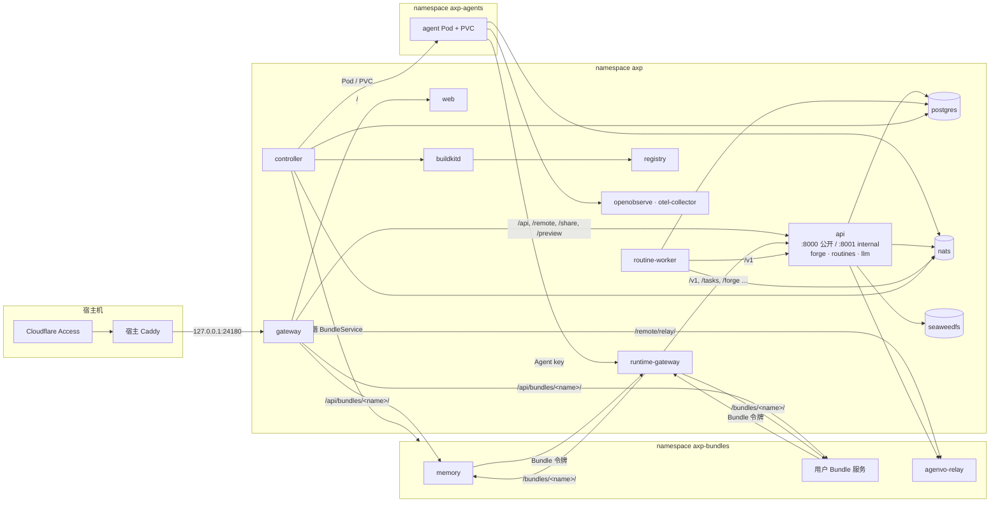

# k3s 部署与 Bundle 服务：架构

本文描述目标架构，覆盖 [#242](https://github.com/AkaraChen/axp/issues/242)（k3s 部署）、[#243](https://github.com/AkaraChen/axp/issues/243)（Bundle 服务）、[#244](https://github.com/AkaraChen/axp/issues/244)（Memory/Relay 内置 Bundle）、[#245](https://github.com/AkaraChen/axp/issues/245)（LLM 合入 control-plane）。怎么从现状走到这里，见[实现文档](implementation.md)。

## 概览

- AXP 跑在单节点 k3s 上：核心、基础设施、Agent、Bundle 服务分别在三个 namespace。
- control-plane 仍是一个二进制、三个进程：`api`（公开 + internal 两个 listener，含 forge、routines、LLM）、`routine-worker`、`controller`。
- Agent 由 `controller` 直接管理 Pod 和 PVC；镜像由集群内 BuildKit 构建，存在集群内 registry。
- Bundle 除了脚本和插件，还能带 Kubernetes YAML 声明服务。每个 Bundle 服务是一个 `BundleService` 自定义资源，由 `controller` 调谐成普通工作负载。
- memory 和 agenvo relay 是内置、必选的 Bundle 服务，与用户 Bundle 走同一条通路。
- 信任边界由 NetworkPolicy 划定；Agent 和 Bundle 服务都只能经 `runtime-gateway` 进入平台，按各自的身份授权。



## 工作负载

| 工作负载          | 类型                                  | 职责                                                                                                                                                   |
| ----------------- | ------------------------------------- | ------------------------------------------------------------------------------------------------------------------------------------------------------ |
| `gateway`         | Deployment                            | 浏览器入口（`public.caddy`），路由见下文                                                                                                               |
| `runtime-gateway` | Deployment                            | Agent 与 Bundle 服务进入平台的唯一入口（`runtime.caddy`），`forward_auth` 认 Agent key 和 Bundle 令牌                                                  |
| `web`             | Deployment                            | SSR 与静态资源                                                                                                                                         |
| `api`             | Deployment，1 副本，`Recreate`        | `axp-control-plane serve`：公开 listener `:8000`、internal listener `:8001`；含 forge、routines 管理、LLM（CPA）；签发 Bundle 令牌；写 `BundleService` |
| `routine-worker`  | Deployment，1 副本                    | 定时任务的执行、恢复、修订；LLM 经 `api:8001/v1`                                                                                                       |
| `controller`      | Deployment，1 副本                    | Agent 的镜像、Pod、派发与事件导入；调谐 `BundleService`；advisory lock 保证同时只有一个                                                                |
| `buildkitd`       | Deployment，1 副本 + PVC              | 构建 Agent 镜像，缓存有上限                                                                                                                            |
| `registry`        | Deployment + PVC                      | 应用、Agent、Bundle 服务的镜像                                                                                                                         |
| `postgres`        | StatefulSet + PVC                     | PostgreSQL 17 + pgvector：`axp`、`axp_routines`，以及各 Bundle 服务的库                                                                                |
| `nats`            | StatefulSet + PVC                     | JetStream：runtime 事件、定时任务计划                                                                                                                  |
| `seaweedfs`       | StatefulSet + PVC                     | Artifact 的 S3（也可换外部 S3）                                                                                                                        |
| `openobserve`     | StatefulSet + PVC                     | 日志与 trace                                                                                                                                           |
| `otel-collector`  | Deployment                            | 无凭据的 OTLP 入口，给 Agent 用                                                                                                                        |
| Agent             | Pod + PVC，`axp-agents`               | 每个 Agent 一个，由 `controller` 管                                                                                                                    |
| Bundle 服务       | 由 Bundle 的 YAML 决定，`axp-bundles` | memory、agenvo-relay、用户的                                                                                                                           |

`api` 持有两个 RWO 卷（GitHub App 凭据 `axp-forge`、模型账号凭据 `axp-llm`），所以单副本、先停后起。SSE 连接在重启时断开，浏览器带 `Last-Event-ID` 重连。

## 网络与信任边界

| namespace     | 入站                                                                                                                                                              | 出站                                                                         |
| ------------- | ----------------------------------------------------------------------------------------------------------------------------------------------------------------- | ---------------------------------------------------------------------------- |
| `axp`         | `api:8000` 只来自 `gateway`；`api:8001` 只来自 `runtime-gateway`、`routine-worker`、`controller`；`nats`、`otel-collector` 另收 `axp-agents`；其余只收 `axp` 内部 | 不限                                                                         |
| `axp-agents`  | 只来自 `controller`（runtime 控制接口 `:8080`）                                                                                                                   | `runtime-gateway`、`nats`、`otel-collector`、DNS、公网（排除集群和节点网段） |
| `axp-bundles` | 两个网关、`controller`、`api`（relay 客户端）、同一 Bundle 的 Pod                                                                                                 | `runtime-gateway`、DNS、公网                                                 |

NetworkPolicy 由 k3s 自带的策略控制器执行。服务之间不共享密钥，也不各自鉴权：能连到一个端口的只有该连的调用方。`api` 的 runtime 路由只在 internal listener 上，`gateway` 只连公开 listener。

## 身份与授权

| 调用方           | 凭据                                                               | 网关注入                           | 能访问                                                                                            |
| ---------------- | ------------------------------------------------------------------ | ---------------------------------- | ------------------------------------------------------------------------------------------------- |
| 浏览器           | Cloudflare Access（外层）                                          | `X-Request-Id`；删掉所有 `X-AXP-*` | 公开 listener、`/api/bundles/<name>/`                                                             |
| Agent            | `<agent>.<HMAC(AXP_SECRET_KEY)>`                                   | `X-AXP-Agent-Id`、`X-AXP-Group-Id` | `/v1`；它的 Bundle 带来的插件路由；`/forge` 凭据；`/bundles/<name>/`（需载入该 Bundle）           |
| Bundle 服务      | `bundle.<name>.<generation>.<HMAC>`，在 Secret `axp-bundle-<name>` | `X-AXP-Bundle`                     | 只有 `bundle.json` 的 `uses` 里声明的：`llm`（`/v1`），或其他 Bundle 的名字（`/bundles/<name>/`） |
| `routine-worker` | 无（网络可达即可）                                                 | —                                  | `api:8001/v1`，以 `routine-<id>` 记账                                                             |

- `runtime-gateway` 对每个请求先问 `api` 的 `GET /internal/v1/runtime-auth`，带上路由所需的插件或能力；不通过就把 403 原样返回。
- Bundle 令牌的 `generation` 存在数据库里，轮换即撤销；`controller` 把新令牌写进 Secret，并把它的摘要写到 Pod template 注解上，服务随之滚动。
- 用量归属：Bundle 带 `llm` 能力调用 `/v1` 时可以在 `X-AXP-Agent-Id` 里写明记在哪个 Agent 名下（memory 抽取用的就是该 Agent 的模型）；网关同时记下 `X-AXP-Bundle`。这是记账字段，不授予任何 Agent 的权限。
- 在集群里本身不给任何权限：没有令牌的 Bundle Pod 只能连到 `runtime-gateway`，被拒绝。

## Agent 运行时

`controller` 的 tick 循环不变：它从数据库算出每个 Agent 期望的镜像和容器 spec，通过 `container.Driver` 收敛。Kubernetes 实现：

| Driver 方法          | 实现                                                                                                               |
| -------------------- | ------------------------------------------------------------------------------------------------------------------ |
| `Run`                | 删旧 Pod，建新 Pod：镜像、环境变量、资源上限（2 GiB）、PVC `axp-agent-<id>` 挂在 `/agent`，`restartPolicy: Always` |
| `List`               | 按标签 `axp.dev/agent` 列 Pod，`URL` 用 Pod IP 的 `:8080`                                                          |
| `Start` / `Remove`   | 删 Pod 由下一轮重建 / 删 Pod，PVC 保留                                                                             |
| `Base`               | registry 中 `axp-agent-runtime:<环境>` 的 digest                                                                   |
| `Build`              | `buildctl` 调用 `buildkitd`，推送 `registry/axp-agent:<内容摘要>`；失败返回输出末尾                                |
| `HasImage` / `Prune` | registry 的 manifest 查询 / 删除不再引用的 tag，每日 CronJob 做 registry GC                                        |

Agent 的 Dockerfile、内容摘要、空闲时替换、构建失败显示都与现在相同。Agent 用裸 Pod：`controller` 本身就是它的调谐器。k3s 的 `registries.yaml` 让节点从集群内 registry 拉镜像。

## Bundle 服务

### Bundle 的形状

```
apps/agent-runtime/bundles/memory/
  bundle.json
  service/
    kustomization.yaml
    deployment.yaml
    service.yaml
```

```json
{
  "name": "memory",
  "required": true,
  "plugins": ["memory"],
  "service": {
    "protocol": "axp.memory/1",
    "uses": ["llm"],
    "database": true
  }
}
```

- `service/` 是普通的 Kustomize 目录，用户自己写 YAML，没有模板语言。自定义 Bundle 在设置页提交 YAML，存在表 `bundle`。
- 约定：服务必须有一个名为 `<bundle>` 的 Service，端口名 `http`，并在 `GET /.well-known/axp-service` 返回 `{protocol, version, capabilities}`。
- 每个部署一份，被所有载入该 Bundle 的 Agent 共享；服务按 `X-AXP-Agent-Id` 自己隔离数据。
- `service.external: "https://…"` 表示使用已有的外部服务：不部署 YAML，只建 ExternalName Service，其余契约相同。

### `BundleService` 资源

```yaml
apiVersion: axp.dev/v1alpha1
kind: BundleService
metadata: { name: memory, namespace: axp-bundles }
spec:
  revision: 3f2a… # YAML、配置、令牌 generation 的摘要
  protocol: axp.memory/1
  uses: [llm]
  database: true
  external: ""
  manifests: | # kustomize build 的结果
    apiVersion: apps/v1
    kind: Deployment
    …
status:
  observedGeneration: 4
  conditions: [Applied, Ready, Compatible] # metav1.Condition
  version: 1.4.0
  capabilities: [mcp, capture, recall]
```

- **来源在数据库，资源是投影。** Bundle 定义、加密的配置、令牌 generation 在 PostgreSQL（内置 Bundle 在镜像里）。`api` 保存 Bundle 或其配置时用 server-side apply 写 `spec`；`controller` 启动时为内置 Bundle 补齐。手工修改 `spec` 会在下一次保存时被覆盖。
- **一个 kind，`v1alpha1`，只加字段。** 校验用 CRD 自带的 OpenAPI/CEL 规则，没有 webhook，没有版本转换。
- `api` 对 `bundleservices` 只读，用 `status` 给 Web 显示状态。

### 调谐

`controller` 进程里运行一个 controller-runtime manager，在拿到现有 advisory lock 之后启动（自身的 leader election 关闭）。它 watch `BundleService` 和它拥有的 Deployment/StatefulSet，变化即入队，失败退避重试；同一对象不会被并发调谐。每次调谐：

1. 解析 `spec.manifests`。只允许白名单 kind（Deployment、StatefulSet、Service、ConfigMap、Secret、PVC、Job、CronJob、ServiceAccount），且只能在 `axp-bundles`；不合规则整体失败（`Applied=False`），不部分应用。
2. 准备平台提供的 Secret：`axp-bundle-<name>`（令牌，有 `uses` 时）、`axp-bundle-<name>-config`（`ready` 的配置值）、`axp-bundle-<name>-postgres`（`database: true` 时，先在共享 PostgreSQL 上建库 `axp_bundle_<name>` 和同名角色）。
3. 给每个子资源加 ownerReference 和标签 `axp.dev/bundle=<name>`，server-side apply（字段属主 `axp-controller`）。PVC 不加 ownerReference。
4. 按标签列出白名单 kind，删除不在本次清单里的子资源（PVC 除外）。
5. 用 kstatus 判断子资源是否就绪，写 `Ready`；就绪后读一次 `/.well-known/axp-service`，主版本与 `spec.protocol` 不同则 `Compatible=False`。

删除 `BundleService` 时，子资源由 Kubernetes 的垃圾回收器级联删除；PVC 和数据库保留，设置里另有“删除数据”。

### 权限

`controller` 的 ServiceAccount 在 `axp-bundles` 只有一个 Role：上面的白名单 kind 和 `bundleservices`（含 `status`）。没有 ClusterRole，不能创建 RBAC 对象，碰不到其他 namespace。`axp-bundles` 启用 Pod Security `baseline`，并有 `ResourceQuota`/`LimitRange`。Bundle 的 YAML 视为管理员提交的受信配置，这些限制约束的是出错时的影响范围。

### 路由

| 网关              | 路径                   | 上游                                    | 鉴权                                                                         |
| ----------------- | ---------------------- | --------------------------------------- | ---------------------------------------------------------------------------- |
| `gateway`         | `/api/bundles/<name>/` | `<name>.axp-bundles.svc` 的 `http` 端口 | Access（用户）                                                               |
| `runtime-gateway` | `/bundles/<name>/`     | 同上                                    | Agent key，且该 Agent 载入了这个 Bundle；或 Bundle 令牌且 `uses` 含此 Bundle |

路由用 Caddy 的路径占位符拼出上游地址，新增 Bundle 服务不改网关配置。服务按路径前缀区分来自用户还是来自 Agent。Bundle 不能声明 Access 放行的公开路径；relay 的 `/remote/relay/` 是写在 `public.caddy` 里的内置路由。

### 可用性

必选 Bundle 的服务不就绪时，Agent 照常运行，相关路由返回 503 `BUNDLE_SERVICE_UNAVAILABLE`，Web 在设置和 Agent 页显示 `BundleService` 的状态。`api` 的就绪不依赖任何 Bundle 服务。

## 内置 Bundle 服务

|          | memory                                                        | agenvo-relay                                                                                               |
| -------- | ------------------------------------------------------------- | ---------------------------------------------------------------------------------------------------------- |
| Bundle   | `memory`，必选                                                | `agenvo`，必选                                                                                             |
| 工作负载 | Deployment 1 副本                                             | StatefulSet 1 副本 + PVC（SQLite）                                                                         |
| 镜像     | `axp-memory:<版本>`，独立构建                                 | `axp-relay:<agenvo 版本>`，从固定的 agenvo 提交构建                                                        |
| 协议     | `axp.memory/1`：MCP、`/capture`、`/recall`、记忆管理接口      | `agenvo.relay/<主版本>`：管理 API、MCP、配对                                                               |
| 数据     | 库 `axp_bundle_memory`（表 `memories`，pgvector）             | PVC：设备配对与 OAuth 授权                                                                                 |
| 平台依赖 | `uses: [llm]`：用 Agent 自己的模型抽取事实                    | 无                                                                                                         |
| 谁调用   | Agent（`/bundles/memory/`）、浏览器（`/api/bundles/memory/`） | 远程电脑的 connector（`/remote/relay/`）；`api` 的 relay 客户端（管理员密钥在 `axp-bundle-agenvo-config`） |

- 两者都没有“关闭”开关；配置用 Bundle 的 `config` schema 表单。
- relay 的 `/.well-known/axp-service` 额外返回 agenvo 版本；`api` 下发 connector 安装命令前与 connector 的期望版本比较，不兼容时在远程电脑页提示更新 connector。
- memory 的接口、Provider、隔离规则见[记忆](../../architecture/memory.md)，不因部署方式改变。

## LLM

CPA 嵌在 `api` 进程里：模型账号和目录的管理接口 `/api/llm/*` 挂在公开 listener，OpenAI 兼容的推理接口 `/v1/*` 挂在 internal listener。control-plane 内部（模型校验、目录缓存）直接调用模块，不经 HTTP。

- 调用方：Agent 和 Bundle 服务经 `runtime-gateway`，`routine-worker` 直连 `api:8001`。
- 凭据、`models.json`、`usage.json` 在卷 `axp-llm`，路径不变。
- `api` 的就绪只看两个 listener；上游账号或某个模型的故障只体现在模型目录的状态里。
- 其他行为（Connector、状态归一化、用量记账）见 [LLM 网关](../../architecture/llm-gateway.md)。

## 部署形态

- **安装物**：`deploy/k3s/` 下一个 Kustomize base（CRD、namespace、工作负载、NetworkPolicy、RBAC、CronJob）和一个 `overlays/production`；一个安装脚本从 `~/.config/axp/production.env` 生成 Secret，再 `kubectl apply -k`。
- **k3s**：单节点，关闭 traefik 和 servicelb。
- **入口**：`gateway` 绑定 `127.0.0.1:24180`。宿主 Caddy、Cloudflare Access 配置不变：Access 放行 `/remote/`、`/share/artifacts/`、`/preview/artifacts/`，其余都要登录。
- **存储**：`local-path`，PV 回收策略 `Retain`，PVC 与原 Docker 卷同名（`axp-postgres`、`axp-nats`、`axp-objects`、`axp-forge`、`axp-llm`、`axp-relay`、`axp-openobserve`、`axp-agent-<id>`）。
- **备份**：每日 CronJob：`pg_dumpall` 加 `local-path` 目录快照，写到 `~/axp-backups`，保留 7 天。
- **迁移**：每次部署先用新镜像跑 `axp-control-plane migrate` 的 Job，成功后才更新工作负载；失败时旧版本继续运行。
- **就绪与观测**：每个工作负载有 `readinessProbe`（`api` 两个 listener 各一个）；`OTEL_SERVICE_NAME` 沿用现有命名，`service.version` 为镜像 tag（git commit）；Agent 和 Bundle 服务的 OTLP 都发到 `otel-collector`。
- **更新与回滚**：镜像 tag 即 git commit；回滚是用上一个 tag 重新 apply。迁移保持向前兼容。
- **资源**：现有服务实测约 1.9 GiB（核心 0.35、memory 0.85、基础设施 0.7），每个 Agent 0.06–0.5 GiB；k3s 自身约 0.5–0.8 GiB，buildkitd 空闲约 0.1 GiB。8 核 / 16 GiB 的单机足够。
