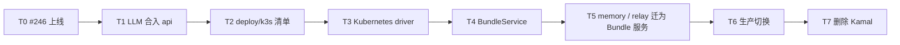

# k3s 部署与 Bundle 服务：实现

本文是把现状改成[目标架构](architecture.md)的步骤：基线、拆分的任务、每步改哪些文件、生产迁移与回滚、验收、成本，以及需要用户决定的事。AXP 任务 #117；审阅后再分派实施。

## 基线

- 代码：main `d0c1e16`（#241 / PR #246 合并后）。Kamal 8 个角色：`gateway`、`runtime-gateway`、`web`、`api`（`serve`）、`llm`、`memory`、`routine-worker`、`controller`；accessory：postgres、nats、relay、s3、openobserve、otel-collector。
- 生产：仍是 `44f4ca7`（#241 之前的 10 个角色）。第一步之前，#246 要先在 Kamal 上线。
- 相关代码：
  - `apps/control-plane/internal/container/container.go`：`Driver` 接口与 Docker 实现（309 行）
  - `apps/control-plane/internal/control/`：tick、镜像、派发
  - `apps/control-plane/internal/api/internal.go`：`runtime-auth`
  - `apps/control-plane/internal/bundles/`：Bundle 与 `config` schema
  - `apps/llm-gateway/`：约 2400 行，不含测试
  - `apps/gateway/{public,runtime}.caddy`
  - `deploy/{deploy.yml,deploy.sh,relay.Dockerfile}`
  - `scripts/dev.sh`

## 任务拆分

T1 在 Kamal 上完成并上线，不依赖 k3s。T2–T5 都在同机的 staging 实例上验证，不碰生产。T6、T7 要用户另行批准。

### T1：LLM 合入 `api`（#245）

1. 审计 CPA SDK：能否只取得它的 gin 引擎或 `http.Handler`，而不让 `cliproxy.Service` 自己监听。
   - 能：把 `/api/llm/*` 挂到公开 listener，`/v1/*` 挂到 internal listener。
   - 不能：CPA 只监听 `127.0.0.1` 的随机端口，两个 listener 在进程内反代，并在 PR 里说明。
2. `apps/llm-gateway/internal/*` 移到 `apps/control-plane/internal/llm/…`；`contract_test.go` 一并移过去，保持通过。
3. control-plane 用到 LLM 的地方（`chat`、`control`、`routines/runner.go`）改为直接调用模块；删除 `AXP_LLM_GATEWAY_URL`。`routine-worker` 改为调用 `http://axp-api:8001/v1`。
4. `serve` 启动 CPA，停机时按顺序关闭；`api` 的就绪不看上游账号。
5. 网关：`public.caddy` 的 `/api/llm/` 指向 `api`，`runtime.caddy` 的 `/v1` 指向 internal listener；删除 `AXP_UPSTREAM_LLM`。
6. 部署：`deploy.yml` 删掉 `llm` 角色，卷 `axp-llm` 改挂到 `api`（路径不变）；`deploy.sh` 的 `RETIRED_ROLES` 加 `llm`。
7. 同步修改 `scripts/dev.sh`、根 `package.json`、`turbo.json`、`deploy/Dockerfile`、`README.md`、`docs/architecture/llm-gateway.md`、`gateway.md`；删除 `apps/llm-gateway`。

验收：

- 真实流式请求，包括中途取消和长连接；Codex 和 Grok 的登录、停用、删除；模型目录与状态；按 Agent 记账；routine 运行。
- 旧卷里的账号原样可用；重启后用量不丢。
- Kamal 角色 8→7。回滚到 T1 之前的版本时，`llm` 角色读同一个卷。

### T2：`deploy/k3s` 清单

- `deploy/k3s/base/`：
  - namespace、PVC（`Retain`）
  - 核心与基础设施的 Deployment/StatefulSet 和 Service
  - NetworkPolicy、ServiceAccount 与 Role
  - 迁移 Job 模板
  - 备份 CronJob、registry GC CronJob
- `deploy/k3s/overlays/production/`：镜像 tag、资源、`127.0.0.1:24180` 的绑定。
- `deploy/k3s/install.sh`，目标 150 行以内，只做这几件事：
  1. 检查 k3s 和 `kubectl`。
  2. 写 `/etc/rancher/k3s/registries.yaml`。
  3. 用 `production.env` 生成 Secret。
  4. 用 Turbo 构建镜像并推到集群内 registry。
  5. 跑迁移 Job 并等待完成。
  6. `kubectl apply -k`，然后等 rollout。
- 每个工作负载的 `readinessProbe` 照搬 `deploy.yml` 的健康检查。
- `staging` overlay：namespace 前缀 `axp-staging`、独立的空库、独立端口，不接 Access。

验收：

- 在 staging 上完成新装、升级、回滚到上一个 tag、重启节点后恢复。
- 迁移 Job 失败时旧版本继续运行。
- 策略测试：Agent Pod 连不到 `api:8000`、`api:8001`、postgres；Bundle Pod 连不到 `api:8001`、postgres；浏览器路径到不了 internal 路由。
- 备份能恢复到一个空的 staging。

### T3：Kubernetes driver

- `internal/container/kubernetes.go`：用 client-go 实现 `Driver`，Pod 与 PVC 的字段见[架构](architecture.md#agent-运行时)。
- `Build` 改为调用 `buildctl`（controller 镜像带上它）；`HasImage`、`Prune` 走 registry API。
- `controller` 按配置选择 driver。
- dev 改用 k3d（见 U1）：`scripts/dev.sh` 创建 k3d 集群，核心进程仍在宿主机热重载；Agent、Bundle 服务、基础设施放进 k3d。
- `buildkitd` 设置 `gckeepstorage` 上限（现在宿主的 build cache 有 45 GB，从未清理）。

验收（staging 与 dev）：

- 新建 Agent、构建、启动、聊天；修改 Bundle 后重建，等空闲时替换；删除 Agent 后 PVC 保留。
- runtime 崩溃后由 kubelet 重启。
- 旧镜像能被清理；构建失败时显示输出末尾。

### T4：`BundleService`（#243）

- `bundle.json` 增加 `service` 段；读取时用元 schema 校验（与 `config` 的做法相同）。表 `bundle` 增加 `manifests` 列和令牌 `generation`。
- `api/v1alpha1` 类型；CRD 与 deepcopy 由 controller-gen 生成，提交到仓库，`turbo` 的 `generate` 任务负责重新生成。
- `api`：保存 Bundle 或配置时，用 kustomize 的 Go 库展开 YAML，算出 `revision`，server-side apply `BundleService`。Web 的 Bundle 页读 `status`。
- `controller`：controller-runtime manager 在拿到 advisory lock 之后启动，调谐步骤见[架构](architecture.md#调谐)；同时负责为声明了 `database: true` 的 Bundle 建库和角色。
- `runtime-auth` 认 Bundle 令牌，按 `uses` 放行；`runtime.caddy` 加 `/bundles/{name}/`，`public.caddy` 加 `/api/bundles/{name}/`。
- Web：Bundle 页显示服务状态和 conditions，提供 YAML 编辑和“删除数据”。

验收（envtest + staging）：

- 重复提交不会重复创建；调谐中途失败后能收敛。
- 从 YAML 删掉一个对象，它会被删除；卸载后 PVC 和库还在。
- 白名单外的 kind 或其他 namespace 被拒绝，且不会部分应用。
- 令牌轮换后旧令牌立即 403；没有令牌的 Pod 什么都调不了。
- 一个示例用户 Bundle 跑通：Agent 和浏览器都能访问。

### T5：memory 与 relay 迁为 Bundle 服务（#244）

- memory：
  - `apps/memory-service` 有自己的 Dockerfile，镜像不再并入应用镜像。
  - `bundles/memory/service/` 放 Deployment 和 Service。
  - 读 `axp-bundle-memory-postgres`，LLM 带令牌走 `runtime-gateway`。
  - 构建上下文仍包含 `packages/telemetry-py`。#116 已取消，以后若重开，只影响这个 Dockerfile。
- relay：
  - `deploy/relay.Dockerfile` 移到 `bundles/agenvo/`；`bundles/agenvo/service/` 放 StatefulSet、PVC 和 Service；`agenvo` 改为 `required: true`。
  - `api` 的 relay 客户端改从 `axp-bundle-agenvo-config` 读管理员密钥，地址用约定的 Service 名。
- 两个服务都实现 `/.well-known/axp-service`。memory 的 hook、MCP 地址从 `/memory/` 改为 `/bundles/memory/`；旧路径在 `runtime.caddy` 保留一个版本的别名。
- 数据：
  - memory：Job 用 `pg_dump -t memories` 导入 `axp_bundle_memory`，校验行数；旧表保留 14 天。
  - relay：Job 用 tar 把卷复制进 PVC。
- 删除 `deploy.yml` 里的 `memory` 角色和 `relay` accessory（在 Kamal 仍在用时，这一步随 T7 一起做）。

验收（staging，数据来自生产快照）：

- memory 的召回、保存、`remember`/`forget`、Web 记忆页、来源群标注都正常，用量记在对应 Agent 名下。
- relay 已配对的设备仍在线；新设备能配对；connector 版本不匹配时有提示。

### T6：生产切换

前提：T1–T5 在 staging 全部通过，并由用户确定停机窗口（U3）。

| 步骤 | 操作                                                                                                   | 回滚点                                               |
| ---- | ------------------------------------------------------------------------------------------------------ | ---------------------------------------------------- |
| 1    | 公告停机；等 Agent 回合结束；`kamal app stop`（accessory 继续运行），排空 NATS 中未消费的 runtime 事件 | `kamal app boot`                                     |
| 2    | `pg_dumpall`，并 tar 全部 Docker 卷，写到 `~/axp-backups/cutover-<日期>`                               | 同上                                                 |
| 3    | 停 accessory；用 Job 把卷内容**复制**进同名 PVC（不移动），把 `axp.memories` 导入 `axp_bundle_memory`  | 重新启动 accessory，然后 `kamal app boot`            |
| 4    | `kamal-proxy` 停止并释放 24180；`install.sh`                                                           | 停止 k3s 的 `gateway`，重新启动 kamal-proxy 和 Kamal |
| 5    | 验收清单（下文）                                                                                       | 同上                                                 |

- 密钥：`production.env` 仍是唯一来源；`AXP_SECRET_KEY` 原样带过去（Agent key、Bundle 配置加密、Bundle 令牌都由它派生）。
- 宿主 Caddy、Cloudflare Access 都不改：端口相同，路径相同。
- 观察 7 天：Kamal 的容器停着不删，Docker 卷不删。这期间回滚会丢失切换后写入的数据，除非先把 k3s 里的库导回；README 写明导回步骤。

切换验收：聊天（含 SSE 重连）、任务、定时任务的触发与报告、GitHub 连接与 PR、Artifacts 的上传/分享/预览、远程电脑、记忆、模型账号、OpenObserve 中能看到各服务日志。

### T7：删除 Kamal

7 天无回滚之后：

- 删除 `deploy/deploy.yml`、`deploy/deploy.sh`、`deploy/secrets`、kamal-proxy、`axp-registry` 容器、Docker driver、controller 对 Docker socket 的挂载。
- 删除 Docker 卷。删除前确认备份仍在，备份保留 30 天。
- 更新 `deploy/README.md`、`docs/architecture/services.md`（新增服务改为“加一个 Bundle 目录”）、`gateway.md`、`bundles.md`、`memory.md`，把本目录的架构内容并入 `docs/architecture/`。

退出条件：仓库里不再有对 Kamal 和 Docker socket 的引用；生产只有一套部署。

## 成本

| 部分  | 删除                                                                                             | 新增（估算）                                                                     |
| ----- | ------------------------------------------------------------------------------------------------ | -------------------------------------------------------------------------------- |
| T1    | llm-gateway 的进程外壳与模块样板、control-plane 的 LLM HTTP client、一个角色、一个 upstream 变量 | CPA 挂载 ≈ 100 行                                                                |
| T2/T7 | `deploy.yml` 331 行、`deploy.sh` ≈ 250 行、kamal-proxy、registry 容器、SSH 回环                  | Kustomize ≈ 500–700 行 YAML、`install.sh` ≈ 150 行                               |
| T3    | Docker driver 309 行、Docker socket                                                              | Kubernetes driver ≈ 300 行、buildctl 与 registry ≈ 100 行                        |
| T4/T5 | memory、relay 在部署里的专属段落；“新增服务清单”中的大部分步骤                                   | 类型 ≈ 80 行（另有生成代码）、调谐 ≈ 250 行、令牌/数据库/路由 ≈ 150 行、Web 状态 |

- 搬家的业务代码（LLM 模块、memory、relay）不计入删除。
- 总行数大致持平或略增。减少的是机制：Kamal、Docker socket、每个服务各自的部署段落。新增服务的边际成本变成写一个 Bundle 目录。
- 运维上多了 k3s 本身（版本升级、kine/SQLite 状态、证书自动轮换），少了 Kamal 的 SSH 回环、registry 和 proxy；另外新增了原来没有的每日备份。

## 需要用户决定

| #  | 问题                                          | 默认                                            |
| -- | --------------------------------------------- | ----------------------------------------------- |
| U1 | dev 是否改用 k3d，并删除 Docker driver        | 是。`BundleService` 需要 API server，dev 也要有 |
| U2 | memory 数据迁出主库，进入 `axp_bundle_memory` | 迁，旧表保留 14 天                              |
| U3 | 生产切换的停机窗口（约 10–20 分钟）           | 需要指定                                        |
| U4 | 备份位置与保留期                              | `~/axp-backups`，7 天；切换前的快照保留 30 天   |
| U5 | 何时批准 T6、T7                               | T1–T5 在 staging 通过后，再单独确认             |

以下按默认推进，不再单独确认：namespace 划分、Kustomize、单 CRD `BundleService`、Bundle 服务的命名/端口/发现约定、PVC 与原卷同名、`Retain`、镜像 tag 用 commit、`agenvo` 改为必选。
